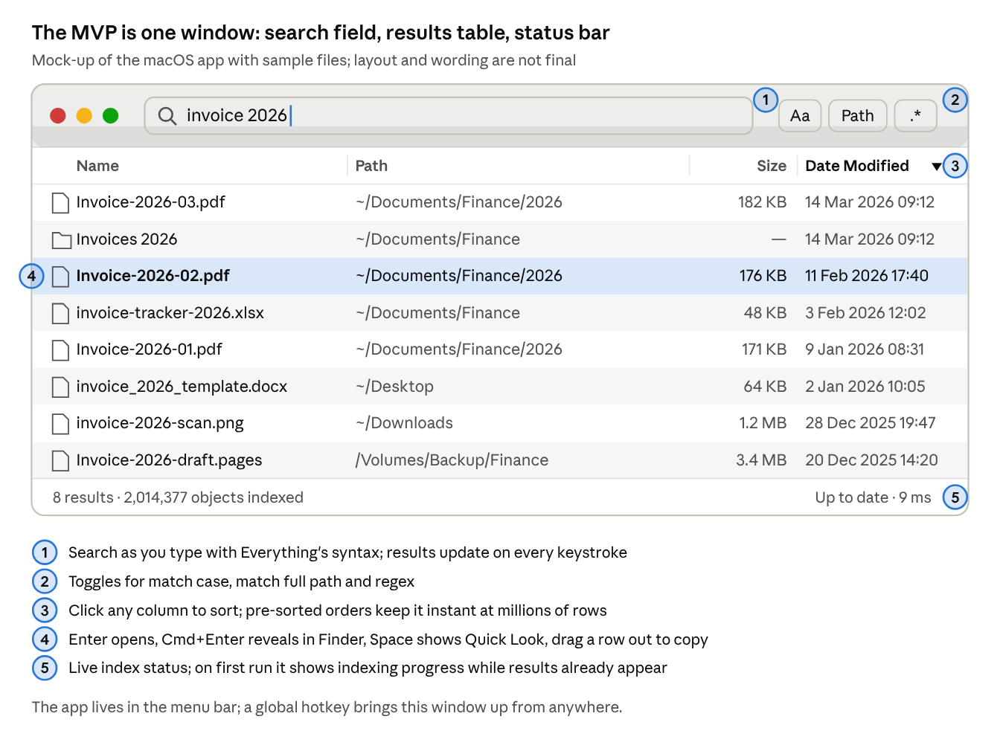
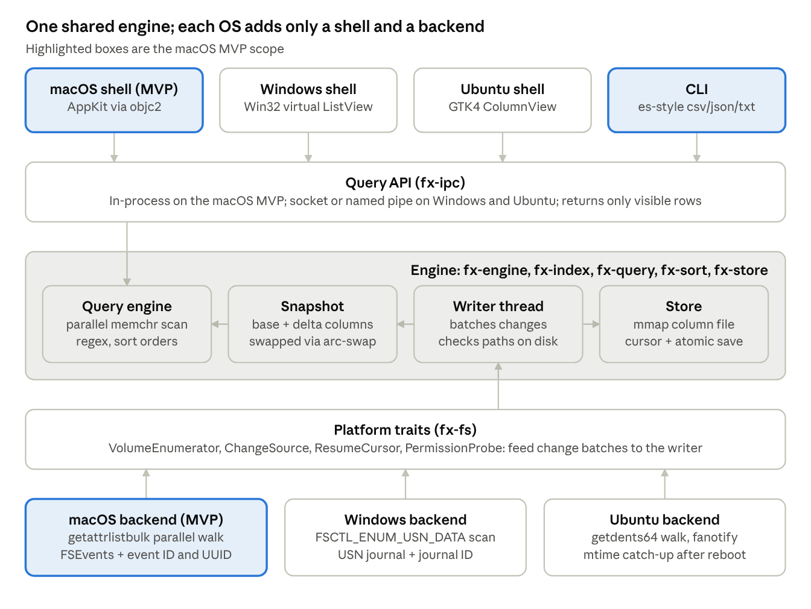

# Not-Everything: research and build plan

> Exported on 2026-11-08 from the owner's private plan document. Until the next export this copy may be edited directly, and the owner mirrors those edits in the plan document. Run status lives in `PROGRESS.md`.

Nov 3, 2026

## Summary

**All three goals can be met on macOS with documented, unprivileged APIs, but startup under 2 s only works from the second launch: it must load a saved index, not scan the disk.** Everything is fast on Windows because it reads the NTFS Master File Table (MFT) and replays the USN change journal. macOS has a good stand-in for the journal (FSEvents, replayable from a saved event ID) but nothing like the MFT. A full scan of about 1.93M entries took 9.3–10.3 s even with 4–6 threads.

| Goal | Verdict on macOS | Evidence | Condition |
| --- | --- | --- | --- |
| Startup under 2 s | Achievable from the second launch | Memory-mapping a 205 MB, 5M-entry index took 1.4 ms; an uncached read took 29–37 ms. FSEvents then replays what changed while the app was closed | The first-ever index takes about 10 s per 2M entries. Show results progressively during that first scan |
| Instant search-as-you-type | Achievable with margin | A plain parallel substring scan searched 5M names in 8.7–10.3 ms on 8 threads, 10M names in 16.6–20.3 ms on 12 threads | Needs a virtualized native table. Full-path and regex queries need their own budgets |
| New files appear near-instantly | Achievable | FSEvents callbacks arrived 11.3–11.9 ms after each create, rename or delete | Events are hints and must be checked against the disk. Some flags force subtree rescans |

Timings are local measurements on an Apple M4 Pro running macOS 27, written in C with a warm cache. They must be re-measured in Rust and from a cold boot (Phase 0).

**Recommended approach.** One platform-agnostic Rust core plus a thin native shell per OS:

- **Core:** names in one contiguous buffer with parent pointers, a multithreaded `memchr` scan, pre-sorted orders, and an index file loaded by mmap with the change cursor in its header.
- **macOS MVP:** a resident app (Dock icon, its own menu bar and a menu-bar item) with an AppKit UI through `objc2` (view-based `NSTableView`) plus an `es`-style CLI. Shipped signed with Developer ID and notarized.
- **Later ports:** Windows uses an elevated indexer service on the USN journal with a Win32 virtual ListView. Ubuntu uses a privileged fanotify daemon with a GTK4 UI. Network drive search and indexing follows in a later release. The Windows and Ubuntu ports will go live in the future, with no set date.
- **Open source:** MIT for the project with Apache-2.0 for designated subcomponents, a distinct product name, and a written clean-room policy.

**Not possible on macOS:** an MFT-style bulk read (the raw disk is root-only), the Mac App Store, Endpoint Security without an Apple-granted entitlement, kqueue watching of a whole disk, seeing changes other machines make on SMB/NFS shares, and a first-ever full index in under 2 s.

## Mock UI

**The macOS MVP is a single native window: a search field, a sortable results table and a status bar, summoned from the menu bar.** This mock-up uses sample files and shows the window as first planned, with standard AppKit controls. Run 1.9 built the window to match it. Since v0.3.0 the app draws its own interface on AppKit, in the 3645 design system, with light and dark versions.



## Everything feature inventory

**The MVP is Everything 1.4's core plus 1.5's comparison grammar and dark mode; 1.5's big subsystems come later.** As of 3 Nov 2026, Everything is at 1.4.1.1032 stable and 1.5.0.1424b beta ([downloads](https://www.voidtools.com/downloads/); [1.5 forum thread](https://www.voidtools.com/forum/viewtopic.php?t=9787)). The Triage column records when each feature is planned.

| Area | Feature | Triage | Clone / macOS note | Source |
| --- | --- | --- | --- | --- |
| Syntax | Operators: space = AND, `\|` = OR, `!` = NOT, `< >` grouping, quotes | MVP | Parse to an AST. OR binds before AND by default | [Search Syntax](https://www.voidtools.com/support/everything/search_syntax/) |
| Syntax | Wildcards `*`, `?` and `**`; a wildcard pattern must match the whole name | MVP | Route `*.ext` to an extension column | [Search Syntax](https://www.voidtools.com/support/everything/search_syntax/) |
| Syntax | Toggles: match case, whole word, match path, diacritics, regex | MVP | Diacritics via NFD with combining marks stripped | [Searching](https://www.voidtools.com/support/everything/searching/) |
| Syntax | Modifiers `case:` `path:` `file:` `folder:` `ww:` `wfn:` `regex:` `start-with:` `end-with:` and `no-` forms | MVP |  | [Search Modifiers](https://www.voidtools.com/support/everything/search_modifiers/) |
| Syntax | Functions `ext:` `size:` `dm:` `dc:` `da:` `parent:` `depth:` `len:` `empty:` `count:` `attrib:` | MVP | Map `attrib:` to directory, hidden, symlink, locked | [Searching (1.4)](https://www.voidtools.com/he-il/support/everything/searching/) |
| Syntax | Comparison and range grammar: `size:1kb` matches 1024–2047 bytes, `size:==1kb` exactly 1024 | MVP | Easy to unit-test; match exactly | [Search Functions](https://www.voidtools.com/support/everything/search_functions/) |
| Syntax | Size constants (`tiny` … `gigantic`) and date forms (`today`, `lastweek`, ISO 8601) | MVP |  | [Searching (1.4)](https://www.voidtools.com/he-il/support/everything/searching/) |
| Syntax | Macros `audio:` `doc:` `exe:` `pic:` `video:` `zip:` | MVP | Custom macros come later | [Searching](https://www.voidtools.com/support/everything/searching/) |
| Syntax | Regex (PCRE) | MVP | Rust `regex` lacks look-around and back-references; document the dialect | [Searching](https://www.voidtools.com/support/everything/searching/) |
| Syntax | Hierarchy: `child:` `childcount:` `descendant` `sibling` | Later | Needs a child index | [Search Functions](https://www.voidtools.com/support/everything/search_functions/) |
| Syntax | Duplicates: `dupe:` `distinct:` `unique:` and Find Duplicates | Later |  | [Find Duplicates](https://www.voidtools.com/support/everything/find_duplicates/) |
| Syntax | `content:` search (unindexed, slow by design) | Later |  | [Searching](https://www.voidtools.com/support/everything/searching/) |
| Syntax | Property functions and property indexing (1.5) | Later | Spotlight attributes are a possible source (not evaluated) | [Properties](https://www.voidtools.com/support/everything/properties/) |
| Syntax | Pinyin, soundex, formula and UI-control functions | Out of scope |  | [Search Modifiers](https://www.voidtools.com/support/everything/search_modifiers/) |
| Syntax | Windows-only: `frn:`, alternate data streams, `owner:`, `shell:` | N/A on macOS | Revisit `frn:` in the Windows port | [Search Functions](https://www.voidtools.com/support/everything/search_functions/) |
| Indexing | Name and path always; size and date modified by default; created, accessed, attributes optional | MVP |  | [Indexes](https://www.voidtools.com/support/everything/indexes/) |
| Indexing | Fast sort: pre-sorted name, path, size and date orders | MVP | 4 B per file per order | [Indexes](https://www.voidtools.com/support/everything/indexes/) |
| Indexing | Real-time updates | MVP | One FSEvents stream per volume | [FAQ](https://www.voidtools.com/faq/) |
| Indexing | Catch up on changes made while closed | MVP | FSEvents replay keyed by volume UUID | [FAQ](https://www.voidtools.com/faq/) |
| Indexing | Exclusions (hidden, system, folders, wildcards, regex) and include-only folders | MVP |  | [Indexes](https://www.voidtools.com/support/everything/indexes/) |
| Indexing | Rebuild, rescan, pause and resume monitoring | MVP |  | [Command Line Options](https://www.voidtools.com/support/everything/command_line_options/) |
| Indexing | Removable and FAT volumes; network drives (SMB/NFS) | Later | Network drives come in a later release (Phase 6), kept fresh by rescans | [Options](https://www.voidtools.com/support/everything/options/) |
| Indexing | Folder size, recent changes (`rc:`), Index Journal (1.5) | Later | Index Journal fits on top of FSEvents input | [Index Journal](https://www.voidtools.com/support/everything/index_journal/) |
| Indexing | File lists (EFU): open, index, export | Later | Publicly documented UTF-8 CSV | [File Lists](https://www.voidtools.com/support/everything/file_lists/) |
| Indexing | In-memory content indexing (1.5) | Out of scope |  | [forum p=35395](https://voidtools.com/forum/viewtopic.php?p=35395) |
| UI | Search box, sortable multi-column results, status bar | MVP | View-based `NSTableView`, fixed row height | [Using Everything](https://www.voidtools.com/support/everything/using_everything/) |
| UI | Open, reveal, copy full path, drag out | MVP | Enter opens, Cmd+Enter reveals in Finder | [Keyboard Shortcuts](https://www.voidtools.com/support/everything/keyboard_shortcuts/) |
| UI | Global hotkey, tray icon, run in background | MVP | Menu-bar item plus one summon hotkey | [Keyboard Shortcuts](https://www.voidtools.com/support/everything/keyboard_shortcuts/) |
| UI | Search from Spotlight: type Not-Everything, press Tab, then type a search | Later | Not scheduled (owner request, 4 Nov 2026; moved out of v0.2.0 on 7 Nov 2026). Spotlight lists matching files from the app's own index, and choosing one opens it. When the wanted file is not listed, an entry opens Not-Everything with the same search. The run 2.8 spike found that Spotlight's Tab scope lists only content donated to Core Spotlight, which the plan rules out copying: on macOS 27.0.1 Spotlight never called an App Intents extension, nor intents in an app's own Swift executable | Owner request |
| UI | Dark mode (1.5) | MVP | Light and dark designs; follows the system, or Light or Dark in Settings | [What's New](https://www.voidtools.com/support/everything/whats_new/) |
| UI | Preview pane and thumbnails | Later | Quick Look on Space is an early win | [Results](https://www.voidtools.com/support/everything/results/) |
| UI | Rename, delete, copy, paste, undo (1.5) | Later |  | [Results](https://www.voidtools.com/support/everything/results/) |
| UI | Search and run history, bookmarks, sidebars, tabs (1.5) | Later | Run count is a cheap ranking win | [Run History](https://www.voidtools.com/support/everything/run_history/) |
| UI | Explorer shell context menu | N/A on macOS | Use Open With and Reveal in Finder | [Options](https://www.voidtools.com/support/everything/options/) |
| Integration | `es` CLI: csv, efu, json, txt output; exit codes 0–9 | MVP | Mirror the contract so scripts keep working | [Command Line Interface](https://www.voidtools.com/support/everything/command_line_interface/) |
| Integration | SDK/IPC and HTTP server | Later | Own versioned socket protocol; HTTP with TLS | [SDK](https://www.voidtools.com/support/everything/sdk/); [HTTP Server](https://www.voidtools.com/support/everything/http/) |
| Integration | ETP/FTP server, Everything Server, plugins | Out of scope |  | [ETP](https://www.voidtools.com/support/everything/etp/); [Plugins](https://www.voidtools.com/support/everything/plugins/) |
| Integration | Everything Service and UAC elevation | N/A on macOS | Becomes the Windows indexer service | [Everything Service](https://www.voidtools.com/support/everything/everything_service/) |

Three documentation conflicts need settling before writing conformance tests: attribute letter P (sparse in 1.4, pinned in 1.5), Ctrl+T (always on top vs new tab), and 1.5 features with no documented semantics, such as weighted searches and formula functions.

## How Everything gets its speed

**Everything builds its index by reading the NTFS MFT and keeps it current from the USN journal; a clone can copy four of its five ideas on macOS, but not the MFT read.** The developer states the MFT is read for indexing and the USN journal is used only to stay up to date. Because Windows maintains the journal, changes made while Everything is closed are caught at the next start ([forum p=50913](https://voidtools.com/forum/viewtopic.php?p=50913); [FAQ](https://www.voidtools.com/faq/)).

- **Privileged reader, unprivileged UI.** A small Everything Service (about 1 MB of RAM) reads raw volumes; the UI runs as a standard user. The cost: any local user can list every NTFS file name through it ([Everything Service](https://www.voidtools.com/support/everything/everything_service/)).
- **Names, not paths.** Each entry stores a parent pointer instead of a full path ([forum p=43863](https://voidtools.com/forum/viewtopic.php?p=43863)).
- **Known cost per column.** Size, date and each pre-sorted order cost 8 bytes per file ([forum p=31241](https://voidtools.com/forum/viewtopic.php?p=31241)). The FAQ gives about 100 MB of RAM and 45 MB of disk per million files, and about 1 minute to index 1M files.
- **No source backs the "1 million files per second" claim** that circulates online.
- **Saved on exit only.** The index lives in RAM and is written to `Everything.db` on exit ([Indexes](https://www.voidtools.com/support/everything/indexes/)).
- **Slow path for everything else.** FAT, exFAT and network shares use folder indexing: a full scan, change monitoring with a 64 KB buffer, a rescan on overflow, and a daily rescan ([Folder indexing](https://www.voidtools.com/support/everything/folder_indexing/)). This is the closer template for macOS.

| Everything ingredient | macOS equivalent | Transfers? |
| --- | --- | --- |
| Direct MFT read for the first index | None without root. Parallel `getattrlistbulk` reaches about 200–295k entries/s | No: the first index takes about 10 s per 2M entries |
| USN journal for live updates and catch-up | FSEvents per-volume store, replayed from a saved event ID | Yes, with caveats: events are coalesced and renames unpaired |
| Names-only RAM index with parent pointers | Same design, about 46–80 B per entry | Yes |
| Pre-sorted orders | `u32` permutations, 4 B per entry | Yes |
| Elevated service plus standard-user UI | User-granted Full Disk Access; root adds little | Partly |
| Database saved on exit | mmap-able checkpoint, saved periodically and on exit | Yes, improved |

The macOS product must therefore treat the first full index as a one-time, progressive event and serve everything else from the saved snapshot.

## macOS: what is possible and what is not

**FSEvents can replace the USN journal, but nothing replaces the MFT, so the first index is slow and every later start must come from a snapshot.** No root or Endpoint Security is needed; Full Disk Access (FDA) from the user is.

| Area | Possible | Possible with caveats | Not possible |
| --- | --- | --- | --- |
| Indexing | Parallel `getattrlistbulk` walk: about 180k entries/s on one thread, 200–295k/s on 4–6 threads | Mount points and firmlinks need care to avoid double-indexing. Some folders are unreadable without FDA. Cold-boot speed unmeasured | Raw APFS reads without root. `searchfs` (11–13 s per query) or Spotlight (skips dot-files and system folders) as the source |
| Change detection | Per-file FSEvents at about 11–12 ms. Replay after restart from a saved event ID plus volume UUID | Flags are hints. Replay merges events per path. Renames arrive as two unpaired events. Dropped events force subtree rescans; a UUID change forces a full rescan | Endpoint Security without an Apple entitlement. kqueue at whole-disk scale (370k folders vs a 92k open-file limit) |
| Permissions | Developer ID app with user-granted FDA. A degraded mode without FDA | No API to check FDA. Consent prompts for Desktop, Documents, Downloads, removable, network and iCloud. Apple announced stricter FDA granting on 2 Oct 2026 | Mac App Store (sandbox required). Data Vaults, even with root |
| Volumes | Per-volume streams for internal and external APFS and HFS+ | FAT/exFAT history is unreliable. Read-only volumes have no history | Events for changes other machines make on SMB/NFS shares |
| Cloud files | Names of not-downloaded iCloud and File Provider items | Materialization must be switched off and `EDEADLK` handled | Recursing into cloud-only folders without risking downloads |

**Scanning.** `getattrlistbulk` returns name, type, file ID, flags, dates and size for many entries per call; Apple's own `fts` is built on it. Without FDA, a scan of `/` found 1.93M entries and 370k folders in 9.3–10.3 s on 4–6 threads (31 s on one). Names averaged 17.3 bytes, and only 24 of 1.93M contained non-ASCII bytes. APFS keeps names as written but compares them normalization-insensitively, so the search copy must be normalized and case-folded ([APFS FAQ](https://developer.apple.com/library/archive/documentation/FileManagement/Conceptual/APFS_Guide/FAQ/FAQ.html)).

**Change detection.** Start a stream per volume with the saved event ID; it delivers history, then a "history done" marker, then live events. The saved ID is valid only while the volume's FSEvents UUID is unchanged. Apple's guide says to start watching before scanning and still do periodic full sweeps ([FSEvents Programming Guide](https://developer.apple.com/library/archive/documentation/Darwin/Conceptual/FSEvents_ProgGuide/UsingtheFSEventsFramework/UsingtheFSEventsFramework.html)). The common Rust crate `notify` cannot save or resume event IDs, so the clone needs its own FSEvents binding ([notify fsevent.rs](https://raw.githubusercontent.com/notify-rs/notify/main/notify/src/fsevent.rs)).

**Lessons from Cardinal.** The closest open-source macOS clone drops a whole batch of changes when any event in it needs a rescan ([issue #229](https://github.com/cardisoft/cardinal/issues/229)). It also never checks the volume UUID before replaying.

**Permissions.** Apple's guidance is to try the access and handle errors, because the privacy database "is not considered API" ([Developer Forums 114452](https://developer.apple.com/forums/thread/114452)). The usual pattern is to probe a known FDA-only file, then deep-link to the Full Disk Access settings pane. Apple's 2 Oct 2026 note says FDA will need "very explicit user action", with no version or API given ([Apple Developer News](https://developer.apple.com/news/?id=p6zjojqw)). Keep onboarding behind an abstraction.

**Volumes.** The root merges the sealed System volume with the Data volume through firmlinks. Walk `/` and skip mount points (detected with `ATTR_DIR_MOUNTSTATUS`, not device IDs), or walk each volume and rewrite paths. Network volumes come in a release after 1.0, kept fresh by rescans.

**Cloud files.** Listing a not-downloaded folder can trigger a download. The scanner must switch off materialization with `setiopolicy_np` and never recurse into cloud-only folders ([TN3150](https://developer.apple.com/documentation/technotes/tn3150-getting-ready-for-data-less-files.md)).

**Resident process.** `SMAppService` registers a login item or LaunchAgent on macOS 13+ ([SMAppService](https://developer.apple.com/documentation/servicemanagement/smappservice.md)). A root daemon adds little. Whether a bundled agent inherits the app's FDA grant is unverified. The FSEvents header is unchanged between the macOS 26.5 and 27.0 SDKs, so the live risk is privacy policy, not the file APIs. Run 2.9 adds a background indexer: a LaunchAgent inside the app bundle, registered with `SMAppService`, runs `fx-engine` with no window from login, so quitting the app never touches the index. The app and the `not-everything` command become its clients over `fx-ipc`, a Unix socket only the user can open; whether the agent needs its own FDA grant waits on run 2.7's decision.

## Windows and Ubuntu outlook

**Both later ports need a privileged indexer process and a thin unprivileged UI; on both, startup under 2 s again comes from a saved snapshot.**

| Goal | macOS (app with FDA) | Windows NTFS/ReFS (elevated service) | Windows FAT/exFAT/SMB | Ubuntu (root daemon + fanotify) |
| --- | --- | --- | --- | --- |
| Startup under 2 s | Yes, from snapshot. First index \~10 s per 2M entries | Yes, from snapshot. First index 5–20+ s on multi-million-file volumes | Yes, from snapshot; background rescan for freshness | Yes, from snapshot; then a directory-mtime check (time unmeasured) |
| Instant search | Yes | Yes | Yes | Yes |
| New files in \~1 s | Yes (\~12 ms measured) | Yes (blocking journal read) | Usually; overflow means a rescan | Yes |
| Changes made while closed | Yes, unless the volume UUID changes | Yes, unless the journal wrapped or was recreated | No, rescan | By re-reading changed directories |

**Windows.**

- **Scan:** `FSCTL_ENUM_USN_DATA` returns MFT records but needs administrator rights; there is no unelevated substitute ([FSCTL\_ENUM\_USN\_DATA](https://learn.microsoft.com/en-us/windows/win32/api/winioctl/ni-winioctl-fsctl_enum_usn_data); [disktree notes](https://docs.rs/crate/disktree/latest/source/docs/mft-fast-path.md)). One project read 6.7M MFT records in 10.3–21.1 s.
- **Catch-up:** save the volume ID, journal ID and next USN with the index, and replay on restart. Rescan fully if entries were deleted or the journal ID changed. A blocking journal read returns as soon as a record is written ([READ\_USN\_JOURNAL\_DATA](https://learn.microsoft.com/en-us/windows/win32/api/winioctl/ns-winioctl-read_usn_journal_data_v0)).
- **Other volumes:** ReFS and Dev Drive need the V1/V3 structures with 128-bit file IDs. FAT, exFAT and SMB need a walk plus `ReadDirectoryChangesW`, which loses everything on overflow and caps network buffers at 64 KB ([ReadDirectoryChangesW](https://learn.microsoft.com/en-us/windows/win32/api/winbase/nf-winbase-readdirectorychangesw)).
- **Crates:** nothing mature; own a small FSCTL layer on `windows-sys`. `usn-journal-rs` 0.5.0 (MIT) is a useful reference.
- **Shipping:** a signed MSI installs the service and UI, with one UAC prompt at install. SignPath Foundation offers free signing to qualifying open-source projects; Azure Artifact Signing costs about $9.99/month ([code-signing options](https://learn.microsoft.com/en-us/windows/apps/package-and-deploy/code-signing-options)). Unlike Everything, the service should not let any local user list every file name.

**Ubuntu (24.04 kernel 6.8, 26.04 kernel 7.0).**

- **Scan:** a parallel `getdents64` walk using `d_type`. `io_uring` has no directory-read operation.
- **Live changes:** fanotify with a filesystem-wide mark and `FAN_REPORT_DFID_NAME` (5.9+) plus `FAN_RENAME` (5.17+) is the true counterpart to FSEvents, but needs `CAP_SYS_ADMIN` ([fanotify\_mark(2)](https://man7.org/linux/man-pages/man2/fanotify_mark.2.html)). btrfs subvolumes and FUSE can refuse the mark.
- **Unprivileged fallback:** inotify needs one watch per folder (about 1.3 KB of kernel memory each, default cap 8,192–1,048,576) and pairs renames unreliably ([inotify(7)](https://man7.org/linux/man-pages/man7/inotify.7.html)).
- **Catch-up:** Linux keeps no journal across reboots. Store each folder's mtime and re-read only folders that changed, as plocate does ([updatedb(8)](https://manpages.debian.org/testing/plocate/updatedb.8.en.html)).
- **Shipping:** a .deb with a systemd service. Flatpak cannot install a system service, and Snap refused FSearch classic confinement in 2022 ([Snapcraft forum](https://forum.snapcraft.io/t/classic-confinement-for-fsearch/30523)).
- **Precedent:** Kestrel (Apache-2.0) runs a root fanotify daemon, filters results by the caller's permissions, and reports about 2.1M files in 5 s at about 230 MB ([Kestrel](https://github.com/Stolly345/kestrel)).

## Search engine and index design in Rust

**A parallel brute-force scan over one contiguous name buffer is fast enough up to 10M files, so no trigram or suffix index is needed.** It searched 5M names in 8.7–10.3 ms on 8 threads and 10M names in 16.6–20.3 ms on 12 threads (local C benchmark; re-measure in Rust).

**Data layout** (design estimate): columns indexed by a `u32` entry ID, about 46 bytes per file lean and 80 bytes with extras, against Everything's \~100.

| Column | Bytes per file | Purpose |
| --- | --- | --- |
| Name buffer (NUL-separated) | \~17–18 | Display name; measured average 17.3 B on the test Mac |
| Name offset | 4 | Position in the buffer |
| Parent | 4 | Parent-pointer tree; renaming a folder touches one entry |
| Size, type, flags (packed) | 8 |  |
| Modified, created times | 8 | Seconds; use `i64` if sub-second precision matters |
| Extension ID | 2 | Makes `ext:` an integer compare |
| Lowercased, normalized search copy | +\~22 | Optional; rebuilt at load in \~10 ms |
| Three pre-sorted orders | +12 | Name, path, size or date |

That is roughly 230–400 MB at 5M files and 460–800 MB at 10M. Oil Find reports a whole Mac of 7.5M files in 343 MB, so 10M is a sensible design ceiling ([Oil Find](https://github.com/oil-oil/oil-find)).

**Query engine.**

- **Substring:** one `memchr::memmem::Finder` per query, scanned in `rayon` chunks aligned to entry boundaries ([memchr](https://docs.rs/memchr/latest/memchr/memmem/index.html)).
- **Regex and wildcards:** `regex`/`regex-automata`, whose literal prefilters skip most of the buffer ([regex internals](https://burntsushi.net/regex-internals/)).
- **Case, Unicode, diacritics:** match against the folded copy; normalize both index and query; strip combining marks.
- **Full path:** never store paths. Compute a per-folder match state top-down, or match the last segment and verify ancestors.
- **Fuzzy (optional):** `nucleo-matcher` ([nucleo](https://github.com/helix-editor/nucleo)).
- **Why not an index:** trigrams cannot narrow 1–2 character queries, which are exactly the first keystrokes ([Russ Cox](https://swtch.com/~rsc/regexp/regexp4.html)). Tantivy splits text into words, so it cannot find "port" inside "report".

**Search-as-you-type.** Bump an atomic generation per keystroke and check it every 65,536 items, as Cardinal does. When the query only grows, filter the previous hits. Keep a small cache of recent result sets so backspace is instant. Send the UI only the generation, total count and visible rows.

**Sorting.** Keep pre-sorted `u32` orders for name, path, size and date, and emit sorted results in one pass filtered by the match set. Apply file changes in batches every 100–500 ms, because inserting into a sorted array one at a time moves megabytes each time.

**Saving and loading.** Store raw little-endian columns in one file. The header holds a version, column offsets with checksums, the volume ID, the FSEvents event ID and UUID, and a clean-shutdown flag. Load with `memmap2` and `bytemuck` without parsing or copying. Do not compress: NVMe reads beat lz4 and zstd decompression. Write to a temp file, flush with `F_FULLFSYNC`, then rename over the old one. Save when idle, on going to the background, and on exit.

| Startup step (estimate) | Time |
| --- | --- |
| Process start and window | 200–500 ms |
| mmap and header check | \~5 ms |
| Rebuild folded search copy | \~20 ms |
| First query pages in \~400 MB | \~100 ms |
| FSEvents replay | Depends on downtime |

**Updates and concurrency.** An immutable base plus a small delta of new and renamed entries and a deletion bitset. One writer thread batches events every 50–200 ms, checks each path on disk, and publishes a new snapshot through `arc-swap`, so searches never wait ([arc-swap](https://docs.rs/arc-swap/latest/arc_swap/)). Compact in the background when the delta passes 5–10% of entries; RAM roughly doubles during the rebuild.

## Native UI and packaging

**Use three thin native shells over one Rust core: AppKit on macOS, a Win32 virtual ListView on Windows, GTK4 on Ubuntu.** Native controls give the smallest binary, the fastest launch, the platform look, and screen-reader support for free. The cost is three small UI codebases.

| Platform | Toolkit | Results table | Status (Nov 2026) |
| --- | --- | --- | --- |
| macOS | `objc2` + `objc2-app-kit` | View-based `NSTableView`, fixed row height; row count and sorting from the core | objc2 0.6.5 (Oct 2026). AppKit bindings last released Oct 2025, and a breaking `define_class!` change is queued ([objc2 CHANGELOG](https://raw.githubusercontent.com/madsmtm/objc2/main/crates/objc2/CHANGELOG.md)) |
| Windows | `windows-sys` | Win32 ListView with `LVS_OWNERDATA`, documented for "millions of items" ([List-View Controls](https://learn.microsoft.com/en-us/windows/win32/controls/list-view-controls-overview)) | Mature. WinUI via `windows-reactor` is too new and has no data grid |
| Ubuntu | `gtk4` + `libadwaita` | `ColumnView` over a custom `GListModel` in Rust, 4–6 columns ([GTK list widgets](https://docs.gtk.org/gtk4/section-list-widget.html)) | Active (gtk4 0.11.5) |

**macOS shell choice.** Pure-Rust `objc2` keeps one language and toolchain. A Swift/AppKit shell over the core through UniFFI is better documented and makes Sparkle, login items and Quick Look easier, at the cost of a second language and an Xcode build; Lokii ships this way ([Lokii](https://github.com/huangy7/lokii)). Recommendation: a one-week `objc2` spike, with the Swift shell as fallback. Do not use SwiftUI `Table`; developers report multi-second hangs at a few thousand rows.

**Helpers that work without Tauri:** `global-hotkey` (Carbon hotkey, no Accessibility prompt), `tray-icon` and `muda` for native menus ([global-hotkey](https://crates.io/api/v1/crates/global-hotkey)).

**Fallbacks if native shells prove too costly:**

- **Tauri 2:** proven by Cardinal with a 6.17 MB arm64 DMG ([Cardinal releases](https://github.com/cardisoft/cardinal/releases)), but web look and webview start-up cost.
- **gpui + gpui-component:** fast, virtual tables and AccessKit built in, but pre-1.0 and pinned to git ([gpui-component](https://github.com/longbridge/gpui-component)).
- **Not recommended:** Slint (GPL unless separately licensed), iced (no upstream accessibility), egui (non-native look).

The only controlled start-up study is from 2023 on Linux: Tauri 5 MB and \~380 ms to full UI, egui 18 MB and \~280 ms ([Kalbertodt 2023](http://lukaskalbertodt.github.io/2023/02/03/tauri-iced-egui-performance-comparison.html)). A native shell is expected to be smaller and faster, but Phase 0 must measure it.

| Platform | Format | Signing | Updates |
| --- | --- | --- | --- |
| macOS | .app in a DMG, Homebrew cask | Developer ID, hardened runtime, notarization, stapling | Sparkle 2 |
| Windows | Signed MSI installing service and UI; winget | SignPath Foundation (free for OSS), Artifact Signing or OV | Own updater or winget |
| Ubuntu | .deb with systemd unit; AppImage for unprivileged mode | Archive signing | apt |

Script `codesign`, `notarytool` and `stapler` directly in CI and use `cargo-packager` to assemble bundles. Homebrew disables casks that fail Gatekeeper from 1 Sep 2026, so notarization is required from the first public build.

Since v0.2.0 (planned as v0.1.4), `scripts/release-macos.sh` does this on the owner's Mac: it signs the app and the command with the owner's Developer ID and the hardened runtime, and notarizes in two uploads, in Apple's order: first the app and the command, then, once the app is stapled, the DMG built from the stapled app, which it staples too. Run 2.6 moves it into CI. v0.2.0 also adds a DMG to the release files (owner, 7 Nov 2026), ahead of the rest of run 2.6; its separate upload was added after the first attempt at release candidate 1 failed `syspolicy_check distribution` on the DMG's app ("Notary Ticket Missing"). Release candidates are built from `rc/X.Y.Z` branches and published as GitHub pre-releases, and releases are built from `main`.

**Updates (Sparkle 2, run 2.6).** The app will update itself with Sparkle 2, the MIT-licensed updater most notarized Mac apps outside the App Store use. It isn't scheduled yet; the owner asked on 8 Nov 2026 to record it here, and it was proposed for the version after 0.3.0.

- **How it works:** the app reads an appcast, an RSS feed over HTTPS listing each version, its build number, its download and an EdDSA (ed25519) signature. Sparkle downloads the update, checks that signature and the Developer ID signature, replaces the app and relaunches it.
- **Full Disk Access carries over:** an update keeps the designated requirement (the bundle ID plus the owner's team), which the release script already checks, so the grant stays.
- **Two feeds:** one for Not-Everything and one for Not-Everything Preview, so release candidates reach testers and never the daily app.
- **The release script:** with `--publish`, `scripts/release-macos.sh` signs the notarized zip with Sparkle's `sign_update` and adds its entry to the feed, with the `CHANGELOG.md` entry as release notes. The EdDSA private key lives in the owner's login keychain, beside the notary profile. Without `--publish` it prints the entry.
- **Hosting:** since 8 Nov 2026 the repository is public, so Sparkle can fetch its GitHub release downloads without a login. The feed still needs an HTTPS host: the repository's releases, GitHub Pages or a static host (the owner's decision).
- **In the app:** a "Check for Updates…" item in the menu-bar menu and a "Check for updates automatically" switch in Settings. Sparkle asks once before it checks on its own, checks at most once a day and sends no system profile.
- **Building it in:** Sparkle is an Objective-C framework. `make_bundle` embeds it in `Contents/Frameworks` and signs it with the app's identity and the hardened runtime, and the Rust side calls it through `objc2`. Its XPC services serve sandboxed apps only, and this app isn't sandboxed, so they stay out. The run records its choice of framework, key and hosting.
- **Licence:** MIT, so the clean-room rules allow it. Its licence text, and those of the parts it bundles, ship in the app and are listed in the README.
- **Homebrew cask:** marked `auto_updates true`, so `brew upgrade` leaves updates to Sparkle.
- **Done when:** an installed build updates itself to the next one from the public feed, both signatures are checked, and Full Disk Access is kept.

## Prior art, licensing and clean room

**No project offers Everything-style search with live updates on macOS, Windows and Linux from one Rust codebase, so there is room for this one; Cardinal (MIT, macOS only) is the best study material.**

| Project | OS | License | Approach | May we read or reuse it? |
| --- | --- | --- | --- | --- |
| [Cardinal](https://github.com/cardisoft/cardinal) | macOS | MIT | Rust engine, Tauri UI, FSEvents resume, \~1.8k stars | Yes, with attribution |
| [Lokii](https://github.com/huangy7/lokii) | macOS | MIT | Rust core, AppKit UI via UniFFI (Oct 2026) | Yes |
| [Oil Find](https://github.com/oil-oil/oil-find) | macOS | MIT | Swift; 7.5M files in 27.2 s at 343 MB (author's figures) | Yes |
| [Kestrel](https://github.com/Stolly345/kestrel) | Linux | Apache-2.0 | Rust root daemon with fanotify, per-caller filtering | Yes |
| [usn-journal-rs](https://github.com/wangfu91/usn-journal-rs), [ntfs](https://github.com/ColinFinck/ntfs) | Windows | MIT / MIT-Apache | USN and MFT building blocks | Yes |
| [Raycast](https://www.raycast.com/blog/the-new-raycast) | macOS | Commercial | Built its own indexer because Spotlight was too slow and inconsistent | Closed |
| [FSearch](https://github.com/cboxdoerfer/fsearch) | Linux | GPL-2.0 | C/GTK3; live updates added July 2026 | GPL: not used |
| [Cling](https://github.com/FuzzyIdeas/Cling), [Orange](https://github.com/naaive/orange), [ANGRYsearch](https://github.com/DoTheEvo/ANGRYsearch) | Various | GPL | Swift; Rust + Tauri (dormant); Python | Do not read or copy |
| [everything-sdk-rs](https://github.com/owtotwo/everything-sdk-rs) | Windows | GPL-3.0+ | Client for the real Everything | Keep out of dependencies |

**Lessons from prior art.** Rescan handling is the hard correctness area ([Cardinal #229](https://github.com/cardisoft/cardinal/issues/229)). Requiring FDA alienates users who only want one external drive ([Cardinal #223](https://github.com/cardisoft/cardinal/issues/223)). Live monitoring forced FSearch to rewrite its database engine, so it must be designed in from day one.

**Why not contribute to Cardinal?** It is macOS-only and Tauri-based, scans single-threaded under a lock, uses a compressed cache that cannot be memory-mapped, and needs nightly Rust.

**Clean-room boundary.** Everything is closed-source freeware ([Wikipedia](<https://en.wikipedia.org/wiki/Everything_(software)>)). Clean-room design defends against copyright claims but not patents, which were not researched ([Clean-room design](https://en.wikipedia.org/wiki/Clean-room_design)).

- **Safe inputs:** voidtools' public support pages, FAQ and forum; Apple and Microsoft docs; MIT/Apache code.
- **Avoid:** disassembling any Everything binary, reverse-engineering `Everything.db` or its service protocol, copying voidtools help text word for word.
- **EFU file lists** can be implemented from the public description (UTF-8 CSV with fixed columns) ([File Lists](https://www.voidtools.com/support/everything/file_lists/)).

**Clean-room rules.** The design in this plan comes from non-GPL sources only. Four rules keep it so; `CLEANROOM.md` has the details, the restricted modules and the record of what the research read.

1. The design spec comes from non-GPL sources only.
2. Anyone who read FSearch's source does not write the index-layout, query-matcher, file-format or sorting modules.
3. A `CLEANROOM` file records which sources each run and change consulted.
4. Nobody reads repositories whose license is unclear.

**License.** MIT for the project as a whole, matching the repository's LICENSE file. Designated subcomponents may use Apache-2.0, for example code adapted from Apache-2.0 projects or a crate where an explicit patent grant matters. Those keep their Apache-2.0 license text and any NOTICE file, and the README lists them; Apache-2.0 code can sit inside an MIT project but cannot be relabelled MIT.

`objc2`, `windows-sys`, `memchr`, `rayon` and `arc-swap` are all compatible. GTK is LGPL, fine with dynamic linking; UniFFI is MPL-2.0, fine unmodified. Slint would force GPL or a separate license.

**Naming.** The owner named the product **Not-Everything** on 4 Nov 2026. That covers the app, its bundle ID `io.3645.not-everything`, the `not-everything` command and its data folder. Release candidates and betas install as a separate app, Not-Everything Preview (bundle ID `io.3645.not-everything.preview`, command `not-everything-preview`, its own data folder), which the owner added to those exceptions. Crates keep the `fx-` prefix, and no other name, bundle ID or Homebrew cask may contain "Everything". Describe it as "inspired by voidtools Everything; not affiliated". On 7 Nov 2026 the owner settled that "Everything" is not trademarked, so the name stays for now and v0.2.0 does not wait on a trademark search; have counsel review the name before the 1.0 launch. This is not legal advice.

## Proposed architecture

**One platform-agnostic engine behind three platform traits, with the indexer/UI split designed in from day one but collapsed into a single process for the macOS MVP.** On macOS root adds almost nothing, so the MVP is one resident menu-bar app that keeps running when its window closes. It talks to the engine through the same request/response API the IPC transport will carry on Windows and Linux, where the indexer must be privileged.



The macOS MVP builds the highlighted shell, CLI and backend; the Windows and Ubuntu ports each add only their own shell and backend over the same engine.

| Platform | Indexer | UI | Transport | Caller check |
| --- | --- | --- | --- | --- |
| macOS MVP | Same process, background threads | AppKit menu-bar app | In-process | n/a |
| macOS later (optional) | LaunchAgent with its own FDA grant (run 2.9) | AppKit app | Unix socket or XPC, owner only | Socket permissions |
| Windows | LocalSystem service | Win32 app as the user | Named pipe with a restrictive DACL | Verify the client's code signature |
| Ubuntu | systemd service with `CAP_SYS_ADMIN` + `CAP_DAC_READ_SEARCH` | GTK4 app | Unix socket in `/run` | `SO_PEERCRED` plus per-user result filtering |

**Crates** (prefix `fx-` kept; the product name stays out of crate names):

| Crate | Responsibility | Platform |
| --- | --- | --- |
| `fx-model` | Shared types: file key, volume ID, entry, change, resume cursor | all |
| `fx-index` | Column store, name buffer, extension table, delta, compaction, snapshots | all |
| `fx-query` | Everything-compatible parser, matchers, refinement cache, cancellation | all |
| `fx-sort` | Pre-sorted orders and batched merges | all |
| `fx-store` | File format, checksums, atomic checkpoint, mmap load | all |
| `fx-engine` | Owns the index, writer thread, checkpoint policy, query API | all |
| `fx-ipc` | Versioned protocol; in-process, Unix socket and named-pipe transports | all |
| `fx-fs` | Platform traits and shared reconcile-by-path logic | all |
| `fx-fs-macos` | `getattrlistbulk` walker, per-volume FSEvents, firmlink mapping, FDA probe, cloud-file policy | macOS |
| `fx-fs-windows` | USN enumerator and journal reader, `ReadDirectoryChangesW` fallback | Windows |
| `fx-fs-linux` | `getdents64` walker, fanotify source, inotify fallback, mtime reconciler | Linux |
| `fx-cli` | `es`-style CLI | all |
| `fx-channel` | Build channel (release, release candidate or beta), fixed at compile time, and the app name, bundle ID, data folder, command, default hotkey, version label and build number that follow from it | all |
| `fx-ui-macos`, `fx-ui-win32`, `fx-ui-gtk` | Native shells | per OS |
| `fx-testkit`, `fx-bench` | Synthetic trees, scripted file changes, ground-truth diff, benchmarks | all |

**Platform traits.** The resume cursor is the key abstraction: an FSEvents event ID plus database UUID on macOS, a journal ID plus next USN on Windows, and none on Linux and FAT, which fall back to mtime reconciliation.

```rust
pub enum ResumeCursor {
    FsEvents { event_id: u64, db_uuid: [u8; 16] },
    Usn { journal_id: u64, next_usn: i64 },
    None { snapshot_epoch: u64 },
}
pub enum Change { Upsert(Entry), Remove { key: FileKey }, CheckPath(PathBuf), RescanSubtree(PathBuf), RescanVolume }
pub enum StartOutcome { Resumed, GapDetected, NoCursorSupport }

pub trait VolumeEnumerator { fn enumerate(&self, root: &Path, sink: &mut dyn FnMut(Entry)) -> Result<()>; }
pub trait ChangeSource {
    fn start(&mut self, from: Option<&ResumeCursor>) -> Result<StartOutcome>;
    fn next_batch(&mut self, deadline: Instant) -> Result<Vec<Change>>;
    fn cursor(&self) -> ResumeCursor; // saved atomically with the index
}
pub trait PermissionProbe { fn full_access(&self) -> AccessState; fn open_settings(&self); }
```

**Startup flow.**

1. Read the header; check format version, clean flag and each volume's identity.
2. mmap the columns, rebuild the search copy, publish the first snapshot. Search works from here.
3. Start each change source from its saved cursor and apply history until "history done".
4. On a gap (UUID change, journal deleted), re-scan in the background while the stale snapshot keeps serving.

**First run:** start the change stream before scanning, as Apple requires, publish snapshots progressively during the scan, then apply buffered events.

**Steady state:** the writer collects 50–200 ms batches, checks each path on disk, routes rescan flags to subtree or volume rescans, publishes a new snapshot, and tells the UI to re-run the current query.

## Phased build plan

**Seven phases, each closed by a gate of measurable criteria: spikes, the macOS MVP, the macOS beta, open source, and network drives in a later release. The Windows and Ubuntu ports (Phases 3 and 4) will go live in the future, with no set date; open source carries no version number.** Durations depend on team size and are not estimated. Targets use the research machine (Apple M4 Pro, 24 GB, macOS 27) plus an 8 GB Apple Silicon Mac as a low-end check.

The checklists below hold every acceptance criterion per phase; tick them off as gates are passed.

### Phase 0: foundations and spikes

- [x] MIT license at the root, Apache-2.0 for designated subcomponents, `CLEANROOM` provenance policy merged; working name chosen; trademark question settled
- [ ] Rust `getattrlistbulk` scanner: ≥180k entries/s on one thread; whole `/` (\~1.9M entries) in ≤10 s warm; scales cleanly to 4–8 workers
- [ ] Rust `memchr` + `rayon` scan: p95 ≤10 ms over 5M synthetic names on 8 performance cores
- [ ] Store: mmap load of a 5M-entry image to first result ≤50 ms warm
- [ ] FSEvents: per-volume stream with saved UUID and event ID replays a scripted offline change set exactly; live latency p95 ≤50 ms
- [ ] UI spike (`objc2` NSTableView vs Swift shell vs Tauri): 2M-row table scrolls at ≤16.7 ms per frame; launch time and `.app` size measured; decision recorded
- [ ] All benchmarks re-run in Rust on two machines, including after a cold boot

### Phase 1: macOS MVP

- [ ] Syntax: ≥300 conformance cases written from the public docs pass 100%
- [ ] Goal 1: launch to first result painted ≤2.0 s p95 over 20 launches with a 2M-entry index (stretch ≤1.0 s), also after a reboot
- [ ] Goal 2: engine p95 ≤16 ms at 2M entries and ≤30 ms at 5M; keystroke to repaint p95 ≤50 ms; regex and full-path p95 ≤100 ms at 2M
- [ ] Goal 3: create, rename or delete shown in an open result list ≤1 s p99 over 1,000 scripted operations (stretch ≤250 ms p95)
- [ ] Offline catch-up: 10,000 changes made while quit; after relaunch the index equals a fresh scan within 10 s, search usable within 2 s
- [ ] First run: \~2M entries in ≤15 s warm, results shown progressively
- [ ] Memory: ≤100 B per entry with default columns
- [ ] `es`-style CLI with csv, json and txt output and documented exit codes

### Phase 2: macOS hardening and public beta

- [ ] Tests for every FSEvents rescan flag, UUID mismatch and stored-ID-too-high; each triggers the right rescan with 0 lost changes
- [ ] 24 h soak with 100k random file operations: 0 differences against ground truth, memory growth ≤5%
- [ ] 200 `kill -9` runs during checkpoints: the index always loads, never corrupts
- [ ] External APFS/HFS+ indexed on mount; FAT/exFAT rescanned; network off by default; no duplicates from `/System/Volumes/Data`
- [ ] iCloud and File Provider folders: indexing triggers 0 downloads
- [ ] Non-FDA mode triggers no consent prompts; an FDA grant is detected within 2 s of app activation
- [ ] VoiceOver reads row, column and total count
- [ ] Notarized DMG passes `spctl --assess`; Homebrew cask installs; a Sparkle update round-trips
- [ ] LaunchAgent prototype tests FDA inheritance; adopt-or-defer decision recorded
- [ ] Later, not scheduled (moved out of v0.2.0 after the run 2.8 spike): typing Not-Everything in Spotlight and pressing Tab lists results from the app's index; a result opens, and an entry opens the app with the same search (run 2.8)
- [x] v0.2.0: releases are signed with the owner's Developer ID and the hardened runtime, and notarized; a quarantined download passes `spctl --assess` as Notarized Developer ID

  Met by the v0.2.0 release on 7 Nov 2026, published from the project's earlier, private repository: Apple accepted both uploads (the app and the command, then the DMG) within minutes, and a copy downloaded from GitHub and quarantined passed `spctl --assess --type open` as Notarized Developer ID and `stapler validate`, with a matching checksum.
- [ ] Background indexer: after a reboot with the app never opened, a file created then is found within 1 s of opening the window (run 2.9)
- [ ] Shortcut recorder: a shortcut picked in Settings shows the window at once and after a relaunch; one macOS can't register is refused with the reason, and the previous shortcut stays (run 2.10)
- [ ] Later, not scheduled: resizable columns. Dragging the divider between two column titles resizes the column on its left, in the header and every row; Date Modified takes the rest; double-clicking a divider restores the default widths; the widths survive a relaunch (run 2.11)
- [ ] Later, not scheduled: right-click menu. Right-clicking a result opens a native menu with the mockups' items in Finder's order: Open, Open With (files only), Reveal in Finder, Quick Look, Copy, Copy Full Path, Share and New Terminal at Folder (folders only); each acts on the clicked row, or on the whole selection when the click is inside it. ⌘C copies the files, as in Finder, and ⌥⌘C copies their full paths (run 2.12)
- [ ] Later, not scheduled: Rename and Move to Trash in the right-click menu, once the owner lifts the read-only rule; Rename edits the name in place, Move to Trash uses the system Trash and ships in beta builds only until the owner has tested it there and approves it for an RC (run 2.13)
- [ ] 0.4.0, first: a performance gate. Every change that ships is measured before its PR against 28 metrics (background CPU, energy, wakeups and disk writes; memory; search speed; freshness and start-up; correctness), each with a target, an allowed regression and a baseline set from 0.3.1; `scripts/perf-check.sh` runs them in three tiers (quick while building, about 30 minutes before a PR, longer for each release candidate) and CI fails a PR that changes shipped code without a passing summary (run 2.18)
- [ ] 0.4.0: background CPU and energy. On the whole-disk index of a Mac in daily use, the app averages ≤1% of one core and ≤50 mW of CPU energy over 30 minutes with the window hidden, and ≤5% with it showing a search, from 34.7% and 0.69 W measured on 0.3.1; a change still shows in an open result list within 1 s, and the app's memory footprint does not grow (run 2.14)
- [ ] 0.4.0: fewer index saves. While changes keep coming, the index is saved once a day, at a moment with no keyboard or mouse input, and when the app quits, from every 5 minutes (about 72 GB written a day) in 0.3.1; a relaunch after `kill -9` a day after the last save still catches up within 10 s (run 2.15)
- [ ] 0.4.0: cheaper search re-runs. A case-insensitive search over 2M entries takes at most half of 0.3.1's time, within the memory budget (run 2.16)
- [ ] 0.4.0: memory. On the whole-disk index (about 2.9M entries) the app's memory footprint is at most 200 MB after 30 minutes with the window hidden and at most 250 MB with it showing a search, from 1.6 to 2.2 GB in 0.3.1 and 0.3.2; the first scan's peak (2.5 GB in 0.3.2) is recorded (run 2.17)

### Phase 3: Windows port (in the future, no set date)

- [ ] One UAC prompt at install, none at runtime; the service rejects unsigned clients
- [ ] 1M-file NTFS volume indexed in ≤20 s
- [ ] ≤2 s startup from snapshot; all offline changes applied when the journal is intact; journal gaps trigger a background re-scan
- [ ] Freshness ≤1 s p99 through a blocking journal read
- [ ] ReFS and Dev Drive with 128-bit IDs; FAT/exFAT through `ReadDirectoryChangesW` with rescan on overflow
- [ ] Virtual ListView scrolls 2M rows at 60 fps and Narrator reads rows; signed MSI and winget manifest published

### Phase 4: Ubuntu port (in the future, no set date)

- [ ] systemd unit with `CAP_SYS_ADMIN` + `CAP_DAC_READ_SEARCH` (not full root) and systemd hardening; one filesystem mark per ext4 volume; btrfs subvolumes handled
- [ ] Freshness ≤1 s p99
- [ ] Reboot catch-up by directory mtimes: 0 differences against a full scan; search usable ≤2 s from snapshot
- [ ] A user without read access to a 0700 folder never sees its contents
- [ ] GTK4 list scrolls 2M rows smoothly and Orca reads rows; .deb and PPA for 24.04 and 26.04

### Phase 5: open source

- [ ] CI green on every supported platform; benchmarks published per release
- [ ] Syntax reference written independently (no voidtools text); compatibility matrix against Everything 1.4 and 1.5
- [ ] Trademark clearance done; dependency license audit clean
- [ ] Threat model and security review of the IPC and privileged daemons
- [ ] CONTRIBUTING guide, code of conduct, issue templates, release process

### Phase 6: network drives (a later release)

- [ ] SMB and NFS shares can be added as opt-in index locations, scanned in full when mounted
- [ ] Scheduled and on-demand rescans keep shares fresh; the interval is configurable
- [ ] A rescan never blocks search; results from the last scan stay visible until it finishes
- [ ] A share that goes offline keeps its last index, marked offline and still searchable
- [ ] Windows adds `ReadDirectoryChangesW` (64 KB network buffer) on top of rescans; Ubuntu uses rescans

## Runs: one session each

**Each phase is split into runs sized for one working session and one pull request, so the plan can be worked through a run at a time.** Size is a rough guide: S fits a short session, M a normal one, and L may need to stop at a checkpoint and finish in a second session.

**How to run one:**

1. Start a fresh session in the repository and ask for the run by its ID, for example "do run 2.1".
2. The run reads only the plan sections it needs plus `PROGRESS.md`, which run 0.1 creates.
3. It follows the project's workflow: agree the run's plan, write failing tests, implement, run tests and CI, self-review, commit on a branch, open a PR.
4. It ends by updating `PROGRESS.md` and the Status column below, then stops. Don't chain runs in one session.
5. If a run is cut short, it commits work in progress on its branch with a note in `PROGRESS.md`, and the next session resumes there.
6. No parallel agents unless the owner asks for them.
7. Mechanical runs, such as scaffolding and packaging, can use a smaller model.
8. Runs 1.1, 1.4, 1.5 and 1.6 (index layout, query matchers, sorting, file format), and every later change to those modules, work from this plan only, never `.claude/research/`, under the clean-room rules.

| Run | Scope | Done when | Size | Status |
| --- | --- | --- | --- | --- |
| 0.1 | Cargo workspace with empty `fx-*` crates, MIT license and Apache-2.0 subcomponent policy, `CLEANROOM.md`, `PROGRESS.md`, CI (fmt, clippy, tests on macOS) | CI green on the empty workspace | S | Done |
| 0.2 | `fx-bench`: synthetic file-tree and name generator, benchmark harness | 5M names generated reproducibly; harness reports p50 and p95 | S | Done |
| 0.3 | Scanner spike: parallel `getattrlistbulk` walker | ≥180k entries/s per thread; `/` in ≤10 s warm | M | Done |
| 0.4 | Search spike: `memchr` + `rayon` scan | p95 ≤10 ms over 5M names | S | Done |
| 0.5 | Store spike: column file and mmap load | 5M-entry load to first result ≤50 ms | S | Done |
| 0.6 | FSEvents spike: own binding, per-volume stream, event ID and UUID replay | Offline change set replayed exactly; p95 ≤50 ms | M | Done |
| 0.7 | UI spike: `objc2` NSTableView with 2M virtual rows | ≤16.7 ms frames; launch time and size recorded; shell decision written | L | Done |
| 0.8 | Phase 0 gate: cold-boot benchmark re-run, decision records, Phase 1 plan agreed | Gate checklist ticked | S | Done |
| 1.1 | `fx-model` + `fx-index`: types, column store, name buffer, extension table | Tests for insert, delete, rename and snapshot pass | M | Done |
| 1.2 | `fx-query` parser, part 1: operators, wildcards, modifiers | About 150 conformance cases pass | M | Done |
| 1.3 | `fx-query` parser, part 2: functions, size and date grammar, macros | All ≥300 conformance cases pass | M | Done |
| 1.4 | `fx-query` matchers: substring, case and diacritics, regex, full path, cancellation, refinement | Search budgets met in benchmarks | M | Done |
| 1.5 | `fx-sort`: pre-sorted orders and batched merge | Output matches a naive sort on random data | S | Done |
| 1.6 | `fx-store`: file format, checksums, atomic checkpoint, mmap load | Corrupt or old files are rejected and rebuilt | M | Done |
| 1.7 | `fx-fs-macos` scanner: mount points, firmlinks, exclusions, cloud-file policy | No duplicates from `/System/Volumes/Data`; 0 cloud downloads | M | Done |
| 1.8 | FSEvents change source plus `fx-engine` writer thread and snapshots | Freshness ≤1 s p99; offline catch-up equals a fresh scan | L | Done |
| 1.9 | `fx-ui-macos`: window, search field, results table, status bar, open, reveal, copy, drag | Matches the mock UI; 2M rows scroll smoothly | L | Done |
| 1.10 | Menu-bar item, global hotkey, login item, FDA onboarding and non-FDA mode | No consent prompts without FDA | M | Done |
| 1.11 | `fx-cli`: `es`-style CLI | csv, json and txt output and exit codes tested | S | Done |
| 1.12 | Phase 1 gate: startup, search, freshness, catch-up and memory benchmarks | Gate checklist ticked | M | Done |
| 2.1 | FSEvents edge-case tests and fixes | Every rescan flag handled with 0 lost changes | M | Not started |
| 2.2 | `fx-testkit` soak and fuzz harness; 24 h soak | 0 differences against ground truth | M | Not started |
| 2.3 | Crash-safety tests: 200 `kill -9` runs during checkpoints | The index always loads | S | Not started |
| 2.4 | External APFS/HFS+ and FAT/exFAT volumes | Indexed on mount, marked offline on unmount | M | Not started |
| 2.5 | VoiceOver support and Quick Look on Space | VoiceOver reads rows and counts | S | Not started |
| 2.6 | DMG, Homebrew cask, Sparkle updates, signing and notarizing in CI (Developer ID signing, notarization and the DMG came early, in v0.2.0, by the owner's decisions of 4 and 7 Nov 2026; the rest stays here) | `spctl --assess` passes; an update round-trips | M | Not started |
| 2.7 | LaunchAgent FDA experiment and public beta | Decision recorded; beta published | S | Not started |
| 2.8 | Search from Spotlight: the app's name, Tab, then a search (later, not scheduled) | A search typed in Spotlight after Not-Everything and Tab lists the app's results and opens them; an entry opens the app with the same search | M | Spike done; moved out of v0.2.0 |
| 2.9 | Background indexer: a LaunchAgent in the app bundle runs `fx-engine` from login; the app and the `not-everything` command become `fx-ipc` clients | After a reboot with the app never opened, a file created then is found within 1 s of opening the window | L | Not started |
| 2.10 | Shortcut recorder in Settings: pick the global shortcut that shows the search window, in place of editing the settings file | A shortcut picked in Settings works at once and after a relaunch; one macOS can't register is refused with the reason, and the previous shortcut stays | S | Not started |
| 2.11 | Resizable result columns (later, not scheduled): a divider between each pair of column titles in the results header, dragged with the mouse or moved with the arrow keys; Date Modified takes the rest, and the table scrolls sideways when the columns don't fit | Dragging a divider resizes its column in the header and every row together, never below the column's minimum; double-clicking it restores the default widths; the widths survive a relaunch; VoiceOver reads and moves each divider | M | Not started |
| 2.12 | Right-click menu (later, not scheduled): a native `NSMenu` on the results with the mockups' items in Finder's order: Open; Open With ▸ for files (the apps `NSWorkspace` lists for the file, the default one marked, then Other…); Reveal in Finder; Quick Look (with run 2.5); Copy (⌘C), which puts the files on the pasteboard as Finder's ⌘C does; Copy Full Path (⌥⌘C, Finder's Copy as Pathname); Share… (`NSSharingServicePicker`); New Terminal at Folder for folders (opens the folder in Terminal). Two differences from the mockups, both macOS limits: the system draws the menu's panel and highlight, and Open With has no "App Store…" item, for which macOS has no public API. ⌘C copies the files, the owner's decision of 9 Nov 2026. Since 0.3.1, ⌥⌘C already copies the paths, and ⌘C and Edit > Copy copy nothing in the results; the run gives ⌘C to Copy, turns Edit > Copy back on in the results for the files, and adds ⌘C Copy to the status bar's hints | Each item does what its Finder counterpart does, on the clicked row or on every selected row when the click is inside the selection; the shortcuts the menu shows are the ones that work, in the menu and in the status bar's hints; ⌘C on the results (and Edit > Copy) puts the files on the pasteboard, so pasting in Finder copies them, and ⌥⌘C puts their full paths, one per line; VoiceOver reads the menu | M | Not started |
| 2.13 | Rename and Move to Trash in the right-click menu (later, not scheduled; waits for the owner to lift the read-only rule in `.agents/rules/product.md`): Rename edits the name in place in the row; Move to Trash moves the clicked row or the selection to the Trash with `trashItemAtURL`. Move to Trash is built into beta builds only (`fx-channel`'s `beta`); RC and release builds leave it out until the owner has tested it thoroughly in a beta and approves it | A renamed or trashed item changes in the results within 1 s; an error (a locked file, no permission, a name already taken) is shown and changes nothing; ⌘⌫ trashes the selection in a beta build; RC and release builds show no Move to Trash item and ignore ⌘⌫ | M | Not started |
| 2.14 | Background CPU and energy (0.4.0; owner, 9 Nov 2026). 0.3.1, measured with the whole-disk index on a Mac in daily use (M4 Pro, 24 GB, macOS 27.0.1, plugged in, 30 min): 34.7% of one core on average and never under 10% in any 10 s, 0.69 W of CPU energy, and an Energy Impact in Activity Monitor of about 35. A stack sample put about 85% of the busy time in the window's search re-runs and about 10% in the writer. The run: (1) the writer notifies subscribers only when a batch changed the index, and a batch that changed nothing publishes its newer cursor silently; today `Writer::commit` makes a new generation and notifies for every batch, up to every 100 ms, even one that changed nothing in the index; (2) the window re-runs its search only while it is on screen; today `ResultsController::on_generation` re-runs at most every 100 ms (`DEFAULT_THROTTLE`) whether or not the window is visible; the window follows `NSWindowDidChangeOcclusionStateNotification` (ordered out, the app hidden, or covered) and re-runs once when it shows again; (3) while it is on screen, re-runs are spaced by the last search's cost (at least 100 ms, and a few times the last search's time) within Goal 3's 1 s; (4) while no window is on screen, the writer collects up to 2 s per batch, so it copies and merges the sort orders (`Order::apply` on a copy in `Writer::commit`) up to 20 times less often, and applies what is pending at once when the window shows; (5) the FSEvents stream's latency, 10 ms today with file-level events (`fx-fs-macos`'s `fsevents/stream.rs`), so a busy disk can wake the app up to 100 times a second, rises to a few hundred ms within Goal 3's 1 s; (6) the writer stops making a fresh copy of the four sort orders for every batch: it merges into a buffer that no search holds any more (such as the previous generation's), because today a search holding the old snapshot keeps both copies alive, which on a Mac short on memory means compression and paging; where this changes `fx-sort`, it works from this plan and the module's own code only (point 8 above); (7) the measurement covers the whole app's memory footprint (2.2 GB median and 3.4 GB at most on 9 Nov), since the ≤100 B per entry gate counts only the snapshot's columns (`fx-engine`'s `memory.rs`) and leaves out the writer's path tree and the per-batch copies; (8) the measurement counts changes per top-level folder, so the folders that cause the most work are known; whether to offer them as suggested exclusions is the owner's decision. Measures with run 2.18's sampler (`fx-bench sample`), which reads `proc_pid_rusage` for a process every 10 s (CPU time, energy, wakeups, disk reads and writes, memory footprint) and takes a stack sample when a 10 s interval passes 150% of one core, so a burst can be traced (0.3.1 had one 10 s burst at 338% and 10 W, with 1.9 GB read; cause unknown) | On the whole-disk index of a Mac in daily use, 30 min with the window hidden average ≤1% of one core and ≤50 mW of CPU energy, and 30 min with the window showing a search ≤5%; Goal 3's freshness (≤1 s p99) and keystroke to repaint (p95 ≤50 ms) still hold; the app's memory footprint, measured the same way, does not grow; the numbers before and after, with the machine and the folders that cause the most changes, are in `PROGRESS.md` | L | Not started |
| 2.15 | Fewer index saves (0.4.0; owner, 9 Nov 2026). A save writes the whole index (about 251 MB for the whole disk) and flushes it with `F_FULLFSYNC`. It is due 30 s after the last change, or at the latest 5 min after the first unsaved one (`DEFAULT_CHECKPOINT_IDLE` and `DEFAULT_CHECKPOINT_MAX_DELAY` in `fx-engine`'s `config.rs`). A whole disk is never quiet for 30 s, so 0.3.1 saved every 5 min: 1.5 GB in the 30-min measurement, about 3 GB an hour (72 GB a day); the app wrote 17 GB in its first 6 hours. The run follows Everything's default ([INI settings](https://www.voidtools.com/forum/viewtopic.php?t=9994)), which saves once a day at a moment without keyboard or mouse input, and on exit: (1) the app saves once 24 h have passed since the last save and there has been no keyboard or mouse input for 1 minute (`CGEventSourceSecondsSinceLastEventType`, checked every 5 minutes); (2) a quit, logout or shutdown saves unsaved changes after the windows have disappeared, where today `Engine::checkpoint_for_quit` saves only when the store has no resume cursor; (3) the longest delay becomes 48 h, a backstop for a Mac that is never idle, and the 30 s idle save is off by default, since a laptop that goes quiet at night would save several times a day; the save after a full rescan stays. A crash still loses nothing: the next launch replays up to a day of changes since the saved cursor, or rescans if macOS no longer has that history. If replaying a day takes longer than Phase 1's catch-up budget, the fallback is a save every 6 hours at an idle moment, with the save on quit. Open point for the owner: the `not-everything` command reads only the saved index (`docs/cli.md`), so its results could be up to a day old instead of 5 min. Either accept that until run 2.9 makes the command a client of the live engine, or have the command ask the running app to save first and wait for it | On the same disk, one save a day while changes keep coming (from 12 an hour), about 0.25 GB written a day plus one save per quit (from about 72 GB); a quit with unsaved changes saves them; after a `kill -9` a day after the last save and a relaunch, the index equals a fresh scan within Phase 1's catch-up budget (10 s); `docs/cli.md` says how old the command's results can be | M | Not started |
| 2.16 | Cheaper search re-runs (0.4.0; owner, 9 Nov 2026; may move to a later release if run 2.14 meets its targets alone). It changes `fx-query` and `fx-index`, so it works from this plan and the modules' own code only (point 8 above). In the 0.3.1 stack sample, most of a re-run's time went to two per-entry costs. Each case-insensitive match folds every name at search time (`fold_str`), because the engine's snapshot keeps no `FoldedColumn`; only `VecView` builds one. And every row read does a SipHash lookup in the delta's override map (`State::slot`), although most rows are untouched base rows. The run keeps a folded name column for the base rows with the snapshot (built once per base; delta rows are folded as now) and marks the overridden base rows in a bitmap, so untouched rows skip the map | A case-insensitive search over 2M entries, with a delta at the compaction limit, takes at most half of 0.3.1's time (`matcher_bench`); Phase 1's search budgets hold; memory stays ≤100 B per entry with the default columns | M | Not started |
| 2.17 | Memory: from 2.2 GB towards 200 MB (0.4.0; owner, 9 Nov 2026: 2.2 GB is unacceptable; Everything uses about 200 MB on Windows, and the app should get to around that). Measured on 2,907,734 entries (M4 Pro, the 0.3.2 Preview's whole-disk index; bytes asked of the allocator, before its rounding): the writer's path tree (`fx-engine`'s `tree.rs`: every live entry again, each with its own name string, plus each folder's children by name) takes 1,054 MB in 9.1M allocations, 362 B per entry; the index columns 220 MB (76 B per entry); the sort orders 46.5 MB (16 B per entry), copied for every batch, and up to four pinned snapshots (`PINNED_SNAPSHOTS` in `fx-ui-macos`'s `source.rs`) each keep their own orders. `vmmap` of 0.3.2, hidden for 30 min: a 1.5 GB footprint, 2.5 GB at its peak during the first scan. The run: (1) drops the writer's path tree; the index answers the three questions it serves (which entry an FSEvents path names, whether an entry changed, which entries lie below a folder) with its key-to-ID table and a children order (by parent, then name; 4 B per entry, searched by halving); (2) serves the saved index from its memory map instead of copying it to the heap at launch (`MappedIndex::to_index`), so its read pages don't count in the footprint and macOS can drop them under memory pressure and read them back from the disk; (3) keeps fewer pinned snapshots, on top of run 2.14's merge of the sort orders without a fresh copy per batch; (4) finds what makes the first scan peak at 2.5 GB and builds the index as the scan goes. It changes `fx-index`, `fx-sort` and `fx-store`, so it works from this plan and the modules' own code only (point 8 above). Phase 1's ≤100 B per entry gate counts only the snapshot's columns; this run measures the whole app, with run 2.18's sampler | On the whole-disk index (about 2.9M entries) of a Mac in daily use: a memory footprint of at most 200 MB after 30 min with the window hidden and at most 250 MB with it showing a search; the first scan's peak is recorded; Goal 2's search budgets, Goal 3's freshness, the first run (about 2M entries in ≤15 s warm) and the offline catch-up (10 s) still hold; the numbers before and after, with the machine, are in `PROGRESS.md` | L | Not started |
| 2.18 | Performance gate (0.4.0, before runs 2.14 to 2.17; owner, 9 Nov 2026: no code that makes the app slower, heavier or busier is merged unless the owner approves it, and regressions are caught before a PR exists). 28 metrics with a target, an allowance and a baseline (`docs/gates/performance.md`, `docs/gates/perf-baseline.toml`): background CPU, energy, wakeups and disk writes with the window hidden and showing a search; the app's memory footprint, its first-scan peak, and bytes per entry in memory and on disk; engine, regex and full-path search, keystroke to repaint, re-sort and scroll; freshness, launch, shortcut to window ready, first scan, first results and catch-up; and three correctness checks, plus the DMG size and the command's query time. Allowances: 5% for sizes and memory, 10% for timings and background cost with floors for small values; none for correctness. Adds to `fx-bench` the sampler (`sample`, from run 2.14's scope), scripted file activity (`churn`) and the comparison (`perf-compare`); to the app, measurement-only flags for a separate data folder, a hidden or searching start state, and shortcut and re-sort probes; `scripts/perf-check.sh` with the quick, pr and rc tiers and a lock so benchmarks never overlap; `scripts/check-perf-report.sh` in CI; and the agent rule `.agents/rules/performance.md` | The script's three tiers run on the M4 Pro; the baseline is measured from 0.3.1's code and committed; CI fails a PR that changes shipped code without a passing summary; the agent rules require the quick steps while building and the pr tier before every PR | L | Done |
| 3.1 | `fx-fs-windows` enumerator (`FSCTL_ENUM_USN_DATA`) | 1M-file volume indexed in ≤20 s | M | Not started |
| 3.2 | USN journal change source and resume cursor | Offline changes applied; gaps trigger a re-scan | M | Not started |
| 3.3 | Windows service, named-pipe `fx-ipc`, client signature check | One UAC prompt at install, none at runtime | L | Not started |
| 3.4 | `fx-ui-win32`: virtual ListView shell | 2M rows at 60 fps; Narrator reads rows | L | Not started |
| 3.5 | ReFS, Dev Drive and FAT/exFAT fallbacks | 128-bit IDs handled; rescan on overflow | M | Not started |
| 3.6 | MSI, signing, winget; Phase 3 gate | Gate checklist ticked | M | Not started |
| 4.1 | `fx-fs-linux` walker and directory-mtime reconciler | Reboot catch-up with 0 differences | M | Not started |
| 4.2 | fanotify change source with inotify fallback | Freshness ≤1 s p99 | M | Not started |
| 4.3 | systemd daemon, Unix-socket IPC, per-user filtering | Unreadable folders stay hidden | M | Not started |
| 4.4 | `fx-ui-gtk`: GTK4 shell | 2M rows scroll smoothly; Orca reads rows | L | Not started |
| 4.5 | .deb and PPA packaging; Phase 4 gate | Gate checklist ticked | S | Not started |
| 5.1 | Independent syntax docs and Everything compatibility matrix | No voidtools text reused | M | Not started |
| 5.2 | License audit, trademark check | Audit clean | S | Not started |
| 5.3 | Threat model and security review of IPC and daemons | Findings fixed or accepted | M | Not started |
| 5.4 | Community files: contributing guide, code of conduct, issue templates | Files published | S | Not started |
| 6.1 | Network share detection and scan-based indexing on macOS | Shares are opt-in; offline shares keep their last index | M | Not started |
| 6.2 | Scheduled and on-demand background rescans, then Windows and Ubuntu shares | Rescans never block search on all three OSes | M | Not started |

## Risks and open questions

**Twenty decisions need an owner's call before Phase 0 closes; each has a suggested default, and the Decision column records the outcome.**

| # | Decision or risk | Why it matters | Suggested default | Decision |
| --- | --- | --- | --- | --- |
| 1 | Product name | "Everything" is voidtools' established name; registries not searched | Distinct name, "inspired by, not affiliated" tagline, trademark search before Phase 5 closes | Override: Not-Everything, bundle ID `io.3645.not-everything` (owner, 4 Nov 2026); trademark: the owner settled on 7 Nov 2026 that "Everything" is not trademarked, so v0.2.0 does not wait on a search; counsel should still review the name before 1.0 |
| 2 | Project license | Sets what code can flow in and out | MIT for the project; Apache-2.0 for designated subcomponents | As suggested: the project is MIT (`LICENSE`); Apache-2.0 only for designated subcomponents, listed in the README |
| 3 | GPL exposure from research | Copied layouts or code would taint the codebase | The four clean-room rules above |  |
| 4 | Build new or contribute to Cardinal | Cardinal already covers much of macOS | New project; study Cardinal with attribution |  |
| 5 | macOS UI shell | Contributor reach vs polish | Pure-Rust `objc2` if the spike passes; Swift shell fallback; Tauri last | Pure-Rust AppKit through `objc2`: the app is built on it from run 1.9, and since v0.3.0 it draws its own 3645 interface on AppKit. The spike's Phase 0 numbers are still to be measured |
| 6 | macOS process model | Startup feel vs complexity and FDA inheritance | Single resident menu-bar app for the MVP |  |
| 7 | Apple's announced FDA tightening | Onboarding may break in a 27.x or 28 release | Permission probe behind a trait; keep a non-FDA mode; test every beta |  |
| 8 | Default index scope | Whole disk vs home folder | Whole boot volume including Library and `node_modules`; skip consent-prompt folders until FDA; exclusion presets |  |
| 9 | External, FAT and network volumes | Top user request; weak event guarantees | External APFS/HFS+ on; FAT/exFAT rescanned on mount; network drives in a later release (Phase 6) |  |
| 10 | Cloud-only files | Accidental downloads, hangs, prompts | Names only; never recurse into cloud-only folders |  |
| 11 | Regex dialect | Everything uses PCRE; Rust `regex` lacks look-around | Use `regex`, document differences, add PCRE only on demand |  |
| 12 | Syntax target | 1.5 has hundreds of functions | 1.4 core plus 1.5 comparison and range grammar |  |
| 13 | Memory budget | Users compare with Everything's \~100 B per file | ≤100 B per entry; design ceiling 10M entries |  |
| 14 | Secondary trigram index | Extra RAM and update complexity | None until entries exceed \~20M or full-path queries miss budget |  |
| 15 | On-disk format | Startup speed vs schema evolution | Hand-rolled columns with `bytemuck` and a versioned header; rebuild on mismatch |  |
| 16 | Unmeasured Rust performance | All benchmarks are C on one machine | Phase 0 re-measures in Rust on two machines, including cold boot |  |
| 17 | Windows signing | SmartScreen reputation is slow; Artifact Signing limited by region | Apply to SignPath Foundation; fall back to Artifact Signing or OV |  |
| 18 | Privacy of privileged indexers | Everything lets any local user list every file name | Windows signer check plus DACL; Linux per-user filtering; macOS owner-only socket |  |
| 19 | Minimum OS versions | API availability vs reach | macOS 13+, Windows 10+, Ubuntu 24.04 and 26.04 |  |
| 20 | When to go public | Provenance and contributor recruitment | Public repository from Phase 0, with no version tied to it | Public: the owner decided on 8 Nov 2026 to publish the repository as `3645-io/Not-Everything`, starting from a fresh first commit; 1.0 stays the launch |

The Phase 0 gate (run 0.8) adopted the suggested defaults of the other items provisionally; they stand until the owner overrides one.

Still to be tested rather than researched: macOS cold-boot scan speed, FSEvents replay after a reboot or Time Machine restore, whether a LaunchAgent inherits FDA, Windows unprivileged journal reads, and whether Ubuntu's AppArmor profiles restrict fanotify.

## Sources and method

Research ran in six tracks: Everything's features, Everything's internals and prior art, macOS indexing, Windows and Linux indexing, index design, and native UI. Each section above cites the pages it relies on.

**Local measurements.** Apple M4 Pro (12 cores, 24 GB), internal SSD, APFS with FileVault, macOS 27.0.1. They were C programs with a warm cache, because no Rust toolchain was installed: directory scans (`getattrlistbulk`, `fts`), FSEvents latency and replay, `searchfs`, and a substring-scan and mmap benchmark over synthetic names. Phase 0 must repeat them in Rust and from a cold boot.

**Weaker evidence.** A few claims rest on search-result summaries rather than opened pages: the SwiftUI `Table` hangs, Homebrew's Gatekeeper deadline, Spotlight's exclusion bugs, network-share event behaviour, and the Ubuntu kernel versions.

**Key primary sources.**

- voidtools: [support site](https://www.voidtools.com/support/everything/), [FAQ](https://www.voidtools.com/faq/), [1.5 changelog thread](https://www.voidtools.com/forum/viewtopic.php?t=9787), developer posts [p=50913](https://voidtools.com/forum/viewtopic.php?p=50913), [p=43863](https://voidtools.com/forum/viewtopic.php?p=43863), [p=31241](https://voidtools.com/forum/viewtopic.php?p=31241)
- Apple: [FSEvents Programming Guide](https://developer.apple.com/library/archive/documentation/Darwin/Conceptual/FSEvents_ProgGuide/UsingtheFSEventsFramework/UsingtheFSEventsFramework.html), [TN3150 dataless files](https://developer.apple.com/documentation/technotes/tn3150-getting-ready-for-data-less-files.md), [SMAppService](https://developer.apple.com/documentation/servicemanagement/smappservice.md), [App Review Guidelines](https://developer.apple.com/app-store/review/guidelines/), [FDA forum guidance](https://developer.apple.com/forums/thread/114452), [Developer News, 2 Oct 2026](https://developer.apple.com/news/?id=p6zjojqw)
- Microsoft: [FSCTL\_ENUM\_USN\_DATA](https://learn.microsoft.com/en-us/windows/win32/api/winioctl/ni-winioctl-fsctl_enum_usn_data), [Change Journals](https://learn.microsoft.com/en-us/windows/win32/fileio/change-journals), [ReadDirectoryChangesW](https://learn.microsoft.com/en-us/windows/win32/api/winbase/nf-winbase-readdirectorychangesw), [List-View Controls](https://learn.microsoft.com/en-us/windows/win32/controls/list-view-controls-overview), [code-signing options](https://learn.microsoft.com/en-us/windows/apps/package-and-deploy/code-signing-options)
- Linux: [fanotify\_mark(2)](https://man7.org/linux/man-pages/man2/fanotify_mark.2.html), [fanotify\_init(2)](https://man7.org/linux/man-pages/man2/fanotify_init.2.html), [inotify(7)](https://man7.org/linux/man-pages/man7/inotify.7.html), [GTK4 list widgets](https://docs.gtk.org/gtk4/section-list-widget.html), [Flatpak permissions](https://docs.flatpak.org/en/latest/sandbox-permissions.html)
- Prior art: [Cardinal](https://github.com/cardisoft/cardinal) (source read at commit `4c50734`), [plocate](https://plocate.sesse.net/), [Kestrel](https://github.com/Stolly345/kestrel), [Oil Find](https://github.com/oil-oil/oil-find), [Lokii](https://github.com/huangy7/lokii)
- Rust: [memchr](https://github.com/BurntSushi/memchr), [regex internals](https://burntsushi.net/regex-internals/), [arc-swap](https://docs.rs/arc-swap/latest/arc_swap/), [bytemuck](https://docs.rs/bytemuck/latest/bytemuck/), [objc2](https://github.com/madsmtm/objc2), [nucleo](https://github.com/helix-editor/nucleo)
