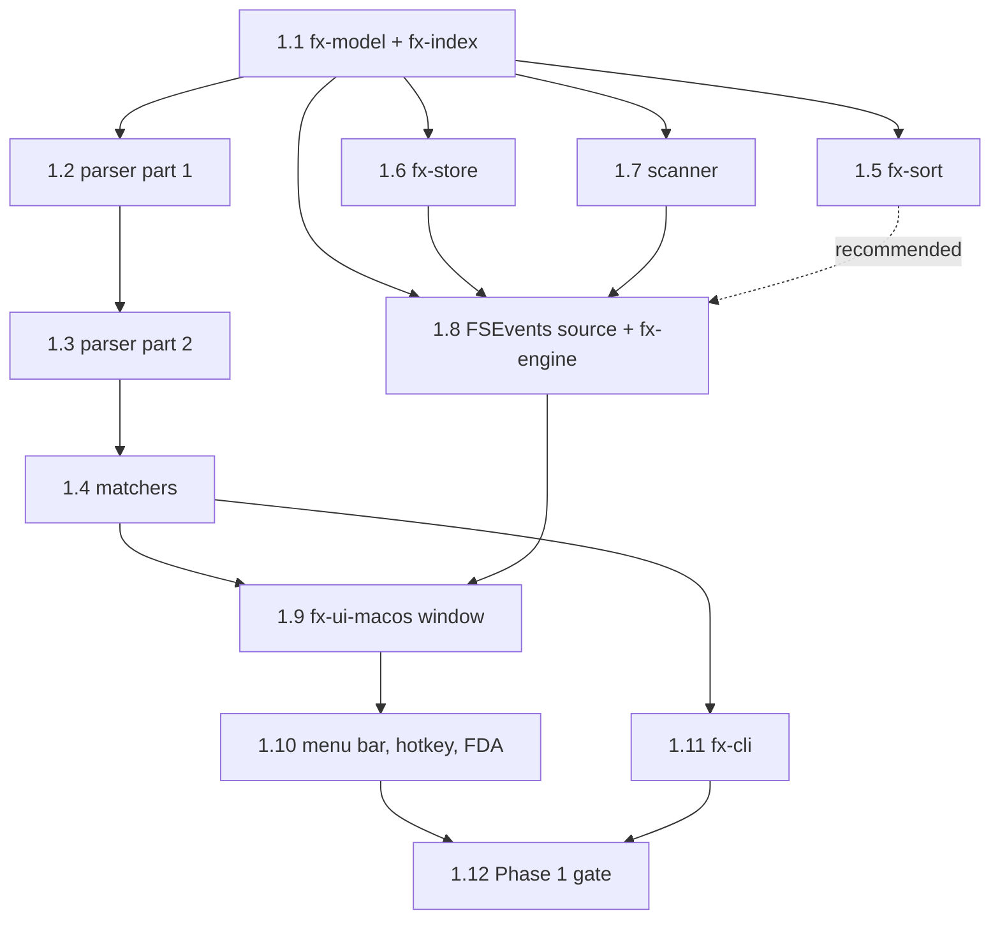

# Phase 1 plan: macOS MVP

> **Historical** (Phase 1 planning, November 2026). Superseded by
> `docs/PLAN.md` and `PROGRESS.md`. Runs 1.1–1.12 are done; this file is kept
> as the record of how Phase 1 was planned, and its questions are marked with
> how they were answered.

- **Status:** Agreed at the Phase 0 gate review (run 0.8). It uses the plan's
  suggested defaults wherever the owner has not answered; the owner may amend
  any part of it.
- **Built from:** `docs/PLAN.md` ("Phase 1: macOS MVP" checklist, the "Runs: one
  session each" table for runs 1.1–1.12, "Proposed architecture" and its crate
  table, "Search engine and index design in Rust", "macOS: what is possible and
  what is not") and the follow-ups in `PROGRESS.md`. `docs/PLAN.md` stays the
  source of truth. If the two disagree, the plan wins.
- **Related:** `docs/gates/phase-0.md` (Phase 0 gate report and measurement
  debt); the macOS UI shell choice (AppKit through `objc2`, provisional until
  the run 0.7 measurements) and the risk-table defaults #1–20 adopted
  provisionally at the Phase 0 gate (`docs/PLAN.md`, "Risks and open
  questions").
- **Phase 0 gate:** not passed, measurements pending. See
  [Phase 0 measurement debt](#phase-0-measurement-debt) for what that means for
  Phase 1.

Phase 1 delivers the macOS MVP. It is one resident menu-bar app with a native
AppKit window (search field, sortable virtual results table, status bar) plus an
`es`-style CLI. Both run over one in-process engine that loads a saved index by
mmap, keeps it fresh from FSEvents, and serves every search from an immutable
snapshot. The app is read-only.

## Contents

1. [Starting point](#starting-point)
2. [Runs 1.1–1.12](#runs-11112)
3. [Dependency order and graph](#dependency-order-and-graph)
4. [Phase 1 gate: who builds and who measures](#phase-1-gate-who-builds-and-who-measures)
5. [Carry-forwards from Phase 0](#carry-forwards-from-phase-0)
6. [Standing rules for every Phase 1 run](#standing-rules-for-every-phase-1-run)
7. [Phase 0 measurement debt](#phase-0-measurement-debt)
8. [Open questions for the owner](#open-questions-for-the-owner)

## Starting point

What Phase 0 left in the workspace, from `PROGRESS.md`:

| Crate | State after Phase 0 | Phase 1 run that takes it over |
| --- | --- | --- |
| `fx-model` | Placeholder | 1.1 |
| `fx-index` | Placeholder | 1.1 |
| `fx-query` | Run 0.4 spike: `substring` (memmem + rayon, cancellation); `NameColumn` is a view over the `fx_bench::Names` layout | 1.2, 1.3 (parser), 1.4 (matchers) |
| `fx-sort` | Placeholder | 1.5 |
| `fx-store` | Run 0.5 spike: `FXSTORE1` version-1 column image, atomic write, mmap load | 1.6 (supersedes the spike) |
| `fx-fs` | Placeholder | 1.7 (shared traits), 1.8 (reconcile-by-path) |
| `fx-fs-macos` | Run 0.3 walker (`getattrlistbulk`, mount-point and dataless rules) and run 0.6 FSEvents spike (`FsEventsCursor`, `StartOutcome`, `VolumeStream`) | 1.7 (scanner), 1.8 (change source) |
| `fx-engine` | Placeholder | 1.8 |
| `fx-ui-macos` | Run 0.7 spike: `objc2` NSTableView over 2M virtual rows, `bundle` writer | 1.9, 1.10 |
| `fx-cli` | Placeholder binary | 1.11 |
| `fx-ipc` | Placeholder | Not planned in Phase 1 (see [open questions](#open-questions-for-the-owner)) |
| `fx-bench` | Generator, harness, `self-bench`, `gate-summary` (run 0.8) | Used by every benchmark; 1.12 adds the Phase 1 gate inputs |
| `fx-testkit` | Workspace policy tests | Updated by every run that implements a crate or adds a dependency |

## Runs 1.1–1.12

One run per session and one pull request per run, as in `docs/PLAN.md`. "Done
when" is the plan's wording. "Depends on" means the run must not start before
those runs are merged.

### 1.1: `fx-model` + `fx-index` (M, clean-room restricted)

- **Scope:** shared types in `fx-model`: file key, volume ID, entry, `Change`,
  `ResumeCursor` (FSEvents event ID plus database UUID, USN journal ID plus next
  USN, `None { snapshot_epoch }`), and the `VolumeEnumerator`, `ChangeSource` and
  `PermissionProbe` trait shapes from "Platform traits". In `fx-index`: the column
  store indexed by a `u32` entry ID, the NUL-separated name buffer with `u32`
  offsets, parent pointers, packed size/type/flags, times, the extension table
  (`u16` extension ID), the delta of new and renamed entries plus a deletion
  bitset, and immutable snapshots.
- **Depends on:** nothing. It goes first because every other run uses its types.
- **Done when:** tests for insert, delete, rename and snapshot pass.
- **Carry-forward:** fx-index owns the name buffer that replaces the
  `fx_bench::Names`-backed `NameColumn` (0.4). Expose a borrowed view (names
  bytes plus offsets) that 1.4 can scan directly.
- **Memory:** lay the default columns out against the ≤100 B per entry gate. The
  plan's design estimate is about 46 B lean and 80 B with extras.
- **Clean room:** works from `docs/PLAN.md` only ("Data layout", "Updates and
  concurrency", "Platform traits"). Never `.claude/research/`. See
  [clean-room rules](#clean-room-runs-11-14-15-and-16).

### 1.2: `fx-query` parser, part 1 (M)

- **Scope:** an Everything-compatible query parser: operators (space as AND, `|`
  OR, `!` NOT, grouping, quoting), wildcards (`*`, `?`) and modifiers (case, whole
  word, path, regex, diacritics and similar). Output is an AST that 1.4 compiles
  to matchers.
- **Depends on:** 1.1. Only by order: the parser needs no fx-index types, but 1.1
  goes first.
- **Done when:** about 150 conformance cases pass.
- **Sources:** conformance cases are written from voidtools' public support
  pages and forum, describing behaviour in our own words. Never copy help text.
  Record the pages consulted in `CLEANROOM.md`.

### 1.3: `fx-query` parser, part 2 (M)

- **Scope:** functions, size and date grammar (comparisons and ranges), and
  macros. The target is the risk table's #12 default: 1.4 core syntax plus the
  1.5 comparison and range grammar.
- **Depends on:** 1.2.
- **Done when:** all ≥300 conformance cases pass. This is the Phase 1 syntax gate
  criterion.

### 1.4: `fx-query` matchers (M)

- **Scope:** substring on the folded and normalized search copy (case, Unicode
  normalization, diacritics stripped), wildcards, regex with the `regex` crate
  (the risk table's #11 default: document the differences from PCRE), full-path matching
  without stored paths (top-down per-folder match state, or last segment plus
  ancestor check), cancellation through the generation counter, and the
  refinement cache (filter previous hits when the query only grows, keep a small
  cache of recent result sets for backspace).
- **Depends on:** 1.3, and through it 1.1. The matchers scan fx-index columns.
- **Done when:** search budgets are met in benchmarks (engine p95 ≤16 ms at 2M,
  ≤30 ms at 5M; regex and full path p95 ≤100 ms at 2M).
- **Carry-forward:** retire the 0.4 `NameColumn` over the `fx_bench::Names`
  layout. Matchers take fx-index's name view. `fx-bench` stays a dev-dependency
  only (generator and harness for tests and `search_bench`). Update
  `search_bench` so it keeps printing its gate line, and update
  `fx-store`'s `load_bench` if 1.6 has not already done so.
- **Also:** add an early-exit or first-N mode. Then "load to first result" stops
  being a full-scan upper bound (noted in the 0.5 row of `PROGRESS.md`).

### 1.5: `fx-sort` (S, clean-room restricted)

- **Scope:** pre-sorted `u32` orders for name, path, size and date. Emit sorted
  results in one pass filtered by the match set. Apply changes as a batched merge
  (batches every 100–500 ms), never one insert at a time.
- **Depends on:** 1.1.
- **Done when:** output matches a naive sort on random data.
- **Clean room:** `docs/PLAN.md` only ("Sorting", "Data layout"). Never
  `.claude/research/`.

### 1.6: `fx-store` (M, clean-room restricted)

- **Scope:** the production file format, which supersedes the 0.5 spike. Raw
  little-endian columns in one file. The header holds a version, column offsets
  with checksums, the volume ID, the FSEvents event ID and UUID (the
  `ResumeCursor` from 1.1, saved atomically with the index) and a clean-shutdown
  flag. Load through `memmap2` + `bytemuck` without parsing or copying, with no
  compression. Write to a temp file, flush with `F_FULLFSYNC`, then rename.
  Checkpoint policy hooks: save when idle, on going to the background, and on
  exit.
- **Depends on:** 1.1.
- **Done when:** corrupt or old files are rejected and rebuilt. The 0.5
  version-1 `FXSTORE1` image counts as an old file.
- **Carry-forward:** the 0.5 spike is superseded. Its format was never stable.
  1.6 redesigns from `docs/PLAN.md` and keeps a spike piece only where the plan
  justifies it. Keep `load_bench` (or its successor) printing
  `GATE load-to-first-result ...` so `fx-bench gate-summary` still collects it.
- **Clean room:** `docs/PLAN.md` only ("Saving and loading", "Data layout").
  Never `.claude/research/`.

### 1.7: `fx-fs-macos` scanner (M)

- **Scope:** production scanner on the 0.3 walker. It covers mount points and
  firmlinks (no duplicates from `/System/Volumes/Data`), exclusions (the risk
  table's #8 default: whole boot volume including Library and `node_modules`, skip
  consent-prompt folders until FDA, exclusion presets) and the cloud-file policy
  (materialization off, never recurse into dataless folders). It also implements
  `VolumeEnumerator` from fx-model/fx-fs.
- **Depends on:** 1.1.
- **Done when:** no duplicates from `/System/Volumes/Data`; 0 cloud downloads.
- **Carry-forward: scanner tuning.** The 0.3 walker reached about 65k entries/s
  on one thread and about 10.4 s for ~2.2M entries on 8 threads (informal, M4
  Pro, warm cache). The Phase 0 targets were 180k/s and 10 s. 1.7 tunes against
  the Phase 1 first-run target: about 2M entries in ≤15 s warm, with results
  shown progressively. Measure first with `scan_bench`
  (`cargo run --release -p fx-fs-macos --example scan_bench -- --root / --threads 1,2,4,6,8 --iterations 5 --warmup 1 --cache warm`),
  then tune and measure again on the same machine and cache state. Candidates:
  - trim the attribute set to what the default columns need;
  - first-call window and buffer sizes;
  - contention on the shared directory queue;
  - per-entry allocation and copying into fx-index.

  Record before and after numbers with the machine, the cache state and whether
  FDA was on. Also add the run 0.3 Apple sources to `CLEANROOM.md`, an open
  follow-up from the 0.3 row.

### 1.8: FSEvents change source plus `fx-engine` writer and snapshots (L)

- **Scope:** `fx-fs-macos` implements `ChangeSource` on the 0.6 `VolumeStream`.
  `fx-engine` owns the index: it runs the startup flow (header check, mmap,
  publish the first snapshot, resume each source from its cursor, background
  rescan on a gap) and the first-run flow (start the stream before scanning,
  publish snapshots progressively, then apply buffered events). One writer thread
  takes 50–200 ms batches, checks each path on disk, routes rescan flags to
  subtree or volume rescans, and publishes snapshots through `arc-swap`. It also
  runs the checkpoint policy with fx-store and gives the query API to the UI and
  CLI. Compaction runs in the background when the delta passes 5–10%. The
  reconcile-by-path logic goes in `fx-fs`.
- **Depends on:** 1.1, 1.6 and 1.7. Merging 1.5 first is recommended so the
  writer applies batches through fx-sort's batched merge. In the recommended
  order below, 1.5 lands before 1.8.
- **Done when:** freshness ≤1 s p99; offline catch-up equals a fresh scan.
- **Carry-forward: the 0.6 review items.**
  - Keep `RawEvent::flags` as the exact kernel flag word. Report the
    directory-rename rescan that the stream adds during replay in a separate
    `rescan_subtree` field, never as an OR-ed `MustScanSubDirs` bit.
  - Add a `dropped_before_cursor()` counter for events dropped because their ID
    is ≤ the saved cursor. Tests assert on that counter in place of the current
    `ev.id > saved` / `before_cursor == 0` checks, which can never fail.
  - Promote `FsEventsCursor` into fx-model's `ResumeCursor::FsEvents` and
    `StartOutcome` into the `ChangeSource` trait's start result. Keep the 24-byte
    cursor encoding or replace it with the 1.6 header field. Delete the
    spike-local types once nothing uses them.
- **Out of scope:** the run 2.1 edge cases (every rescan flag, a stored ID that
  is too high, a UUID change end to end) stay in Phase 2.

### 1.9: `fx-ui-macos` window (L)

- **Scope:** the window from the mock UI: search field, results table, status
  bar. Actions: Enter opens, Cmd+Enter reveals in Finder, copy full path. Drag
  out offers copy and link only. The table is a view-based `NSTableView` with a
  fixed row height, and row count and sorting come from the engine. The window
  re-runs the current query when the engine publishes a snapshot and shows
  results progressively during the first run.
- **Depends on:** 1.4 and 1.8. It also needs the UI shell decision to be final
  (UI measurements, see the measurement debt) or the owner's explicit go-ahead
  on the provisional `objc2` recommendation. (Run 1.9 went ahead on the
  provisional `objc2` choice; the measurements are still pending.)
- **Done when:** it matches the mock UI and 2M rows scroll smoothly.
- **Read-only:** no delete, rename, move or trash action anywhere. Test that the
  drag source's operation mask is copy and link only. Quick Look on Space is run
  2.5.

### 1.10: menu bar, hotkey, login item, FDA onboarding (M)

- **Scope:** menu-bar item (resident app that keeps running when its window
  closes), global hotkey (Carbon hotkey through `global-hotkey`, no
  Accessibility prompt), login item through `SMAppService` (macOS 13+, the
  risk table's #19 default), and FDA onboarding behind the `PermissionProbe` trait
  (probe a known FDA-only file, deep-link to the settings pane). It also covers
  the non-FDA mode, which skips consent-prompt folders.
- **Depends on:** 1.9.
- **Done when:** no consent prompts without FDA.
- **Note:** the risk table's #7 default. Keep onboarding behind the trait, because Apple
  announced stricter FDA granting with no version or API.

### 1.11: `fx-cli` (S)

- **Scope:** an `es`-style CLI over the same engine query API: query syntax from
  1.2–1.4, sorting, result limits, csv, json and txt output, and documented exit
  codes.
- **Depends on:** 1.4. It uses the engine API from 1.8 if 1.8 has merged.
  Otherwise it starts on fx-index plus fx-query over a loaded fx-store image and
  switches to fx-engine before 1.12.
- **Done when:** csv, json and txt output and exit codes are tested.
- **Read-only:** no delete, rename, move or trash subcommands or flags.
- **Policy note:** `fx-cli` is the `BIN_CRATE` in `core_crates.rs`, not one of
  `LIB_CRATES`. `IMPLEMENTED_CRATES` and `CORE_DEPENDENCY_ALLOWLIST` currently
  accept library crates only. 1.11 extends that policy test so `fx-cli` can
  declare its allowlisted dependencies, and keeps the binary name `fx-cli` until
  the product name is chosen. (Answered: the command is `not-everything` since
  v0.1.2.)

### 1.12: Phase 1 gate (M, last)

- **Scope:** benchmarks and scripts for every Phase 1 gate criterion (see the
  [mapping](#phase-1-gate-who-builds-and-who-measures)). The model is
  `scripts/phase0-gate.sh` plus `fx-bench gate-summary`: one command per machine
  and cache state, benchmarks run one at a time, every benchmark printing
  `GATE <criterion>: PASS|FAIL (<value>)`. It also writes the gate report
  `docs/gates/phase-1.md`.
- **Depends on:** every other Phase 1 run.
- **Done when:** gate checklist ticked. If agents can't run release benchmarks
  or the GUI, record the gate as "not passed: measurements pending", as run 0.8
  did, and never tick an unmeasured item.

## Dependency order and graph

Hard dependencies (a run starts only after these have merged):

| Run | Depends on |
| --- | --- |
| 1.1 | none (goes first) |
| 1.2 | 1.1 |
| 1.3 | 1.2 |
| 1.4 | 1.3 (and 1.1) |
| 1.5 | 1.1 |
| 1.6 | 1.1 |
| 1.7 | 1.1 |
| 1.8 | 1.1, 1.6, 1.7 (1.5 recommended) |
| 1.9 | 1.4, 1.8 (and the UI shell decision final) |
| 1.10 | 1.9 |
| 1.11 | 1.4 |
| 1.12 | all of 1.1–1.11 |



Plain-text version:

```text
1.1 ─┬─> 1.2 ─> 1.3 ─> 1.4 ─┬──────────────> 1.11 ─────────────┐
     │                      └─────────┐                         │
     ├─> 1.5 ··(recommended)··┐       │                         │
     ├─> 1.6 ─────────────────┼─> 1.8 ┴─> 1.9 ─> 1.10 ─────────┴─> 1.12
     └─> 1.7 ─────────────────┘
```

**Recommended session order** (one run per session, no parallel agents unless
the owner asks for them):

1.1 → 1.2 → 1.3 → 1.5 → 1.6 → 1.7 → 1.4 → 1.8 → 1.11 → 1.9 → 1.10 → 1.12

Every run in this order has its hard dependencies merged before it starts. The
critical path is 1.1 → 1.2 → 1.3 → 1.4 → 1.9 → 1.10 → 1.12, joined by
1.6/1.7 → 1.8 → 1.9. The two L runs (1.8, 1.9) may need a checkpoint and a
second session. If the owner does allow parallel work, these groups are
independent once 1.1 has merged: {1.2, 1.3, 1.4}, {1.5}, {1.6}, {1.7}.

## Phase 1 gate: who builds and who measures

Every criterion is measured in run 1.12 on the M4 Pro (24 GB) and the 8 GB Apple
Silicon Mac, with the machine and cache state recorded. Criteria that say "after
a reboot" are also measured cold.

| # | Phase 1 gate criterion (`docs/PLAN.md`) | Built by | Measured by | What 1.12 runs |
| --- | --- | --- | --- | --- |
| 1 | Syntax: ≥300 conformance cases written from the public docs pass 100% | 1.2 (~150 cases), 1.3 (all ≥300) | 1.12 | The fx-query conformance suite, with its case count reported |
| 2 | Goal 1: launch to first result painted ≤2.0 s p95 over 20 launches with a 2M-entry index (stretch ≤1.0 s), also after a reboot | 1.6 (mmap load), 1.8 (startup flow, first snapshot), 1.9 (window, first paint), 1.10 (resident app launch) | 1.12 | 20 launch probes warm, plus cold after a reboot, over a saved 2M-entry index (successor of the 0.7 `--launch-probe`) |
| 3 | Goal 2: engine p95 ≤16 ms at 2M and ≤30 ms at 5M; keystroke to repaint p95 ≤50 ms; regex and full-path p95 ≤100 ms at 2M | 1.4 (matchers, cancellation, refinement), 1.5 (sorted output), 1.8 (snapshot query API), 1.9 (keystroke to repaint) | 1.12 | Engine query benchmark at 2M and 5M (successor of `search_bench`), regex and full-path query sets, and a UI keystroke-to-repaint probe |
| 4 | Goal 3: create, rename or delete shown in an open result list ≤1 s p99 over 1,000 scripted operations (stretch ≤250 ms p95) | 1.8 (change source, writer, snapshots), 1.9 (re-run query and repaint) | 1.12 | Scripted 1,000-operation freshness benchmark end to end (successor of `fsevents_bench latency`) |
| 5 | Offline catch-up: 10,000 changes made while quit; after relaunch the index equals a fresh scan within 10 s, search usable within 2 s | 1.6 (cursor saved atomically with the index), 1.7 (fresh-scan ground truth), 1.8 (replay, gap rescan) | 1.12 | 10,000 scripted offline changes, relaunch, diff against a fresh scan (successor of `fsevents_bench replay`) |
| 6 | First run: ~2M entries in ≤15 s warm, results shown progressively | 1.7 (scanner tuning), 1.8 (progressive snapshots), 1.9 (progressive display) | 1.12 | First-run benchmark over `/` (successor of `scan_bench`) plus a check that snapshots are published during the scan |
| 7 | Memory: ≤100 B per entry with default columns | 1.1 (column layout), 1.5 (orders), 1.6 (on-disk image), 1.8 (delta and snapshots) | 1.12 | Resident memory and image bytes per entry at 2M and 5M |
| 8 | `es`-style CLI with csv, json and txt output and documented exit codes | 1.11 | 1.12 | The fx-cli output and exit-code tests, and a check that the documented exit codes match |

Gate benchmarks work only on generated data or under the temp directory, never
delete user files, and need no `rm` or `purge` in the gate script. Cold runs
need a reboot, as in Phase 0.

## Carry-forwards from Phase 0

| From | Item | Goes to | Action |
| --- | --- | --- | --- |
| 0.3 | Scanner below target: ~65k entries/s on 1 thread (gate 180k) and ~10.4 s for ~2.2M entries on 8 threads (gate 10 s); informal, M4 Pro, warm cache | 1.7 | Tune against the Phase 1 first-run target of ≤15 s warm for ~2M entries, measured with `scan_bench` before and after (see 1.7) |
| 0.3 | Apple sources not yet in `CLEANROOM.md` | 1.7 | Add them |
| 0.6 | `RawEvent::flags` gets an added `MustScanSubDirs` bit during replay | 1.8 | Keep the exact kernel flags; add a separate `rescan_subtree` field |
| 0.6 | Before-cursor checks that can never fail | 1.8 | Add a `dropped_before_cursor()` counter and assert on it |
| 0.6 | `FsEventsCursor` and `StartOutcome` are local to `fx-fs-macos` | 1.8 | Promote them into fx-model's `ResumeCursor` and the `ChangeSource` trait |
| 0.6 | Rescan flags, stored ID too high, UUID change end to end | 2.1 | Stays in Phase 2 |
| 0.4 | `fx_query::substring::NameColumn` is backed by the `fx_bench::Names` layout | 1.1, 1.4 | 1.1 provides the fx-index name buffer; 1.4 moves the matchers onto it and retires `NameColumn` |
| 0.5 | Store spike (`FXSTORE1` version 1) | 1.6 | Superseded by the production format; version-1 files are rejected and rebuilt |
| 0.5 | Load-to-first-result is a full-scan upper bound | 1.4, 1.6 | Early-exit or first-N search mode; keep the gate line |
| 0.7 | UI shell decision provisional (objc2 recommended, pending measurement), and with it the risk table's #5 | Before 1.9 | Owner runs the 0.7 measurements (see `docs/gates/phase-0.md`) and makes the decision final |

## Standing rules for every Phase 1 run

These come from `.agents/CLAUDE.md` and the Phase 0 runs, and they apply to every run in
this plan.

### Workspace policy tests

- **`IMPLEMENTED_CRATES`** in `crates/fx-testkit/tests/core_crates.rs`. The run
  that first gives a core crate real code adds the crate here (expected: 1.1 adds
  `fx-model` and `fx-index`, 1.5 adds `fx-sort`, 1.7 or 1.8 adds `fx-fs`, 1.8 adds
  `fx-engine`). Platform crates use `IMPLEMENTED_PLATFORM_CRATES` and
  `PLATFORM_DEPENDENCY_ALLOWLIST` in `platform_crates.rs`. `fx-fs-macos` and
  `fx-ui-macos` are already on that list.
- **`CORE_DEPENDENCY_ALLOWLIST`** in the same file. Each run that adds a
  dependency to a core crate adds it here with its table kind (normal, dev,
  build) and a comment giving its license and purpose. Workspace crates are
  declared as `path = "../fx-…"`. Core crates never depend on `objc2*`,
  `windows*`, `gtk*` or anything named "everything".
- `fx-cli` needs a policy extension in 1.11 (see 1.11).
- Policy tests are only changed to admit a run's own new crate or dependency,
  never weakened.

### Dependency license check

- Before adding any crate, check its license and its new transitive
  dependencies (`cargo metadata`, the crate's license file). MIT, Apache-2.0,
  `MIT OR Apache-2.0` and similarly permissive licenses are fine.
  **No GPL dependencies.** The plan's licensing notes allow LGPL only with
  dynamic linking and MPL-2.0 only unmodified. Call out either one in the PR.
- Record the license in the allowlist comment and in the PR description.
- Likely Phase 1 additions are named in the plan, for example `regex` /
  `regex-automata` (1.4), `arc-swap` (1.8) and `global-hotkey` / `tray-icon` /
  `muda` (1.10). The run that adds one checks its license at that time. Being
  named in the plan is not a license check.
- Apache-2.0 code copied or adapted into the repository is a designated
  subcomponent. It keeps its license text and any NOTICE file, is listed in the
  README, and is never relabelled MIT.

### Clean room: runs 1.1, 1.4, 1.5 and 1.6

- Runs **1.1** (index layout), **1.4** (query matchers), **1.5** (sorting) and
  **1.6** (file format) work from `docs/PLAN.md` only. They never open
  `.claude/research/` (see `CLEANROOM.md`).
- Nobody who has read FSearch's source writes these runs (clean-room rule 2 in
  `docs/PLAN.md`).
- For all runs: never read GPL or unclear-license code (FSearch, Cling, Orange,
  ANGRYsearch, everything-sdk, unlicensed repositories). Never decompile
  Everything or reverse-engineer `Everything.db` or its service protocol. Never
  copy voidtools help text. This applies to 1.2/1.3 conformance cases too.
- Every run records the external sources it consulted in `CLEANROOM.md`.
  Cardinal (MIT) and other MIT/Apache code may be studied with attribution.

### Read-only MVP

- No delete, rename, move or trash action in the app or the CLI.
- Dragging a result out offers copy and link only.
- Allowed actions: Enter opens, Cmd+Enter reveals in Finder, copy full path,
  Space shows Quick Look (run 2.5).
- Never trigger cloud downloads: materialization stays off and dataless folders
  are never entered (1.7, 1.8 rescans included).
- Network drives are out of the MVP (Phase 6). Benchmarks and tests never delete
  anything outside their own temp directories.

### Benchmarks and records

- Run benchmarks one at a time. Record the machine and whether the cache was
  cold or warm next to every number.
- Every gate benchmark prints a `GATE <criterion>: PASS|FAIL (<value>)` line so
  `fx-bench gate-summary` can collect it.
- Never use "Everything" in the product name, crate names, bundle ID or cask.
  Crates keep the `fx-` prefix. (Answered later: the owner named the product
  Not-Everything, bundle ID `io.3645.not-everything`, as the exceptions; the
  crates keep `fx-`.)
- Each run ends by updating `PROGRESS.md` (status, numbers, follow-ups).

## Phase 0 measurement debt

The Phase 0 gate is **not passed: measurements pending**. No agent could run
release benchmarks, the AppKit GUI, or a reboot. The full list, the exact
commands and the empty result slots (M4 Pro and 8 GB Mac, warm and cold) are in
**`docs/gates/phase-0.md`**. The owner runs `scripts/phase0-gate.sh` once per
machine and cache state and pastes each `summary.md` into that report.

Effect on Phase 1:

| Phase 0 debt | Phase 1 runs affected | Effect |
| --- | --- | --- |
| Scanner gate (`scan_bench`): only informal numbers, both gates missed | 1.7 | 1.7 needs a formal baseline before tuning, and must measure on the same machine and cache state |
| Search gate (`search_bench`, p95 ≤10 ms at 5M) unmeasured | 1.4 | Measure the baseline before 1.4 changes the scan; Phase 1's Goal 2 budgets build on it |
| Store gate (`load_bench`, ≤50 ms) unmeasured | 1.6, Goal 1 | The startup budget assumes a fast mmap load; confirm before 1.6 fixes the format |
| FSEvents gates (`fsevents_bench` latency and replay) unmeasured | 1.8, Goals 3 and 5 | Freshness and catch-up rely on them |
| UI gates (`table_spike` autoscroll and launch probe, `make_bundle` size) unmeasured; UI shell decision provisional | 1.9, 1.10 | 1.9 should not start until the decision is final or the owner accepts the provisional choice |
| Generator timing (`self-bench`) unrecorded | none directly | Baseline for the harness |
| Cold-boot and 8 GB Mac runs missing for all of the above | 1.12 | Phase 1 gate numbers have no Phase 0 baseline to compare against |

The pure-code runs 1.1, 1.2, 1.3 and 1.5 do not depend on any of these numbers.
They can proceed while the owner collects them, if the owner chooses to start
Phase 1 before the Phase 0 gate is formally passed.

## Open questions for the owner

All three are answered; the answers follow each question.

1. **Start Phase 1 before the Phase 0 gate passes?** Default: yes for 1.1, 1.2,
   1.3 and 1.5. Hold 1.7 until there is a formal scanner baseline, and hold 1.9
   until the UI shell decision is final.
   **Answered:** Phase 1 went ahead, and runs 1.1–1.12 are done while the
   Phase 0 measurements are still pending. Run 1.9 built on the provisional
   `objc2` choice.
2. **`fx-ipc` in the MVP.** The architecture has the MVP use the same
   request/response API the IPC transport will carry, but no Phase 1 run builds
   `fx-ipc`. Default: 1.8 defines the request/response types in `fx-engine` with
   the in-process transport, and `fx-ipc` stays a placeholder until run 3.3. If
   1.8 puts the types in `fx-ipc` instead, it adds `fx-ipc` to
   `IMPLEMENTED_CRATES`.
   **Answered:** the default. The query API lives in `fx-engine` and `fx-ipc`
   is still a placeholder; run 2.9 (the background indexer) plans its first
   use.
3. **Product name and bundle ID (risk #1, pending owner).** 1.9 and 1.10 use
   a placeholder bundle ID and app name without "Everything" until the name is
   chosen.
   **Answered:** the owner named the product Not-Everything, bundle ID
   `io.3645.not-everything`, on 4 Nov 2026.
